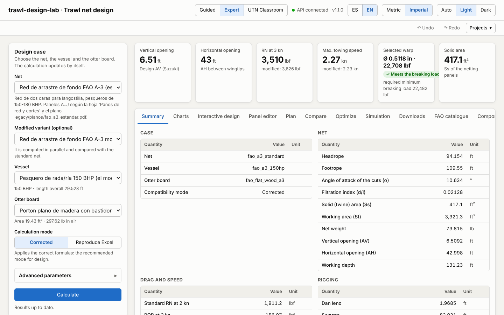
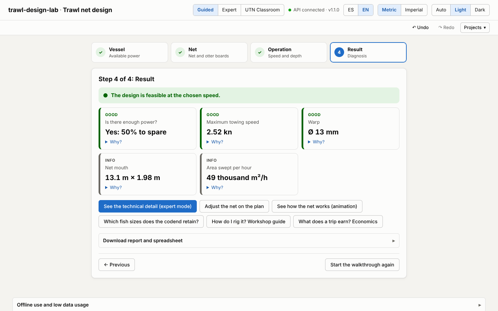
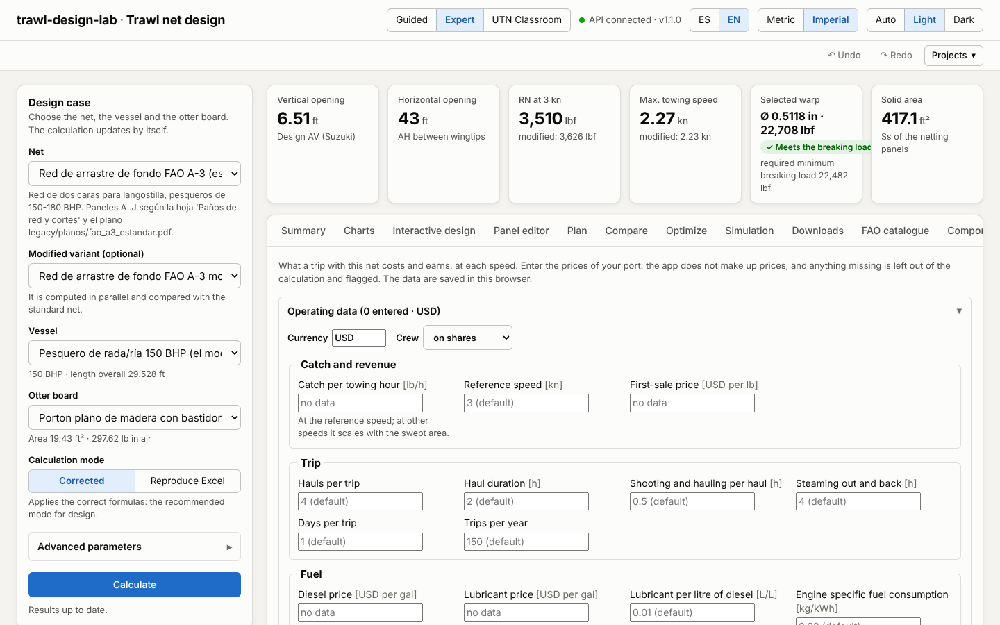

# Web interface

`web/` contains the single-page application **trawl-design-lab · Trawl net design** (React 19 +
Vite + strict TypeScript). It consumes the `trawlkit` HTTP API and lets you build a design case,
edit the panels of the net, see results, charts and plans, compare variants and download the
reports. The interface is available in Spanish and in English (see “Language and units” below);
numbers use the decimal comma in Spanish (`Intl.NumberFormat('es-AR')`) and the decimal point in
English (`en-US`).

**Try it online:** <https://arielgiamportone.github.io/trawl-design-lab/app/> (preview published
with this book; how it is deployed and its limitations in {doc}`despliegue`).





## Getting started in development

Two processes are needed: the API (Python) and the Vite development server (Node 22, npm 10).

```bash
# 1. API (from the root of the repository)
uv sync --all-extras --dev
uv run trawlkit serve --port 8000

# 2. Frontend (another terminal)
cd web
npm ci
npm run dev            # http://localhost:5173
```

By default the frontend calls `http://127.0.0.1:8000` and the API accepts any origin (CORS `*`).
As an alternative, the Vite server (and `vite preview`) exposes a proxy `/api → :8000`:

```bash
VITE_API_URL=/api npm run dev
```

## Build and preview

```bash
cd web
npm run build          # tsc -b + vite build → web/dist/
npm run preview        # serves dist/ at http://localhost:4173
```

`dist/` is static: it can be served from any web server. The API URL is fixed at build time with
`VITE_API_URL`, and the public path with `VITE_BASE` (`/` by default; to serve it under a
sub-path, e.g. `VITE_BASE=/trawl-design-lab/app/`).

On opening, the app waits for the API to answer `GET /health` before requesting catalogues and
computing: it retries with increasing waits for ~90 s (cold start of the free server) and the
indicator in the header goes through “Connecting…”, “Waking up the API (this may take up to a
minute)…” and “API connected”, or “API unavailable” with a “Retry” button
(`src/lib/connection.ts`, `src/state/ConnectionProvider.tsx`).

The initial JavaScript weighs about 95 kB compressed (React apart in its own chunk); Recharts
(~110 kB compressed) is downloaded only when opening the “Charts”, “Compare” or “Optimize” tabs,
and the “Optimize” and “Simulation” tabs are also loaded when opened.

## Environment variables

| Variable | Where | Default value | Use |
|---|---|---|---|
| `VITE_API_URL` | frontend (build) | `http://127.0.0.1:8000` | Base URL of the API. `/api` uses the Vite proxy. |
| `TRAWLKIT_API_TARGET` | `vite.config.ts` (dev/preview) | `http://127.0.0.1:8000` | Target of the `/api` proxy. |
| `VITE_BASE` | frontend (build) | `/` | Public path of the app (`/trawl-design-lab/app/` on GitHub Pages). |
| `VITE_DOCS_URL` | frontend (build) | no link | “Documentation” link in the header (`../` next to the book). |
| `TRAWLKIT_CORS_ORIGINS` | API | `*` | Allowed origins, comma-separated (e.g. `https://redes.example.org,http://localhost:5173`). |
| `TRAWLKIT_MAX_SIM_SECONDS`, `TRAWLKIT_MAX_OPT_GRID`, `TRAWLKIT_ALLOW_REFINE` | API | `30`, `25`, allowed | Cost guards of `/simulate` and `/optimize` (see {doc}`despliegue`). |

There is an example in `web/.env.example`.

## npm scripts

| Script | What it does |
|---|---|
| `dev` | Development server with hot reload. |
| `build` / `preview` | Production build and preview server. |
| `lint` / `format` | ESLint (typescript-eslint, react-hooks) and Prettier. |
| `typecheck` | `tsc -b --noEmit`. |
| `test` | Unit and component tests (Vitest + Testing Library, mocked `fetch`). |
| `test:e2e` | End-to-end tests with Playwright against `vite preview` and the real API. |
| `gen:api` | Regenerates `src/api/schema.d.ts` from `web/openapi.json` (openapi-typescript). |

`web/openapi.json` is the contract generated from the API; it is not edited by hand. If the API
changes, that file is regenerated and then `npm run gen:api` (the CI checks that `schema.d.ts` is
up to date).

## Modes: guided and expert

The app opens in **Guided** mode, intended for those who want a quick answer without knowing all
the parameters. There are four steps:

1. **Vessel**: the vessel from the catalogue (power, length) and the propeller type.
2. **Net**: the net, whether it is compared with another, and the otter boards. The nets suited
   to the power of the chosen vessel are offered (the A-3 and those of the FAO catalogue whose
   trial range, ±25 %, includes it); “See all” removes the filter. Drafts of the catalogue do not
   appear. The **Rig** selector follows the net's rig by default and switches to otter boards,
   pair, outrigger, twin or beam ({doc}`26_aparejos_dobles_y_vara`).
3. **Operation**: the planned towing speed (slider) and the depth.
4. **Result**: a diagnosis with traffic lights. It says whether the power is enough at that speed
   (available pull against the demand of net, otter boards and warps, interpolated to the chosen
   speed; it warns with less than 10 % margin), the maximum towing speed, whether the warp meets
   the breaking load, the mouth of the net and the area swept per hour (mouth width × speed ×
   1852 m). Each point has a “Why?” in plain language and a link to the chapter of the book. If
   the speed cannot be reached, it offers to try the maximum viable one.

**Expert** mode is the complete interface (case panel, advanced parameters and all the tabs). The
two modes share the same case: what is chosen in one appears in the other. The “Guided / Expert”
switch is in the header and the browser remembers the choice.

## Projects, undo and help

- **Undo / Redo** (buttons or `Ctrl+Z` / `Ctrl+Shift+Z` outside text fields): each change to the
  case enters the history; consecutive changes while typing a number are grouped into one step.
- **Projects**: save the case under a name in this browser (up to 30), open it or delete it;
  export it to a `.trawl.json` file to share it and import it again. The file carries a format
  and a version (`trawl-design-lab/project`, 1) and is validated on import.
- **Contextual help**: the “?” button next to a value explains what it is, its unit, its usual
  range and links to the chapter of the book. Outside the usual range a warning is shown, without
  preventing the calculation.

## Interactive design and 3D view

- **Interactive design** (Expert mode tab; also from the Guided mode result with “Adjust the net
  on the plan”): the plan of the net, upper and lower panels, drawn from `POST /design/layout`,
  which is the same geometry as the sheet. Tapping a panel selects it and handles appear: the
  lower edge changes the depth (meshes N) and the outer corners change the edges towards the
  codend and towards the mouth. The plan is drawn at stretched mesh (width = meshes × mesh size;
  height = N × mesh size), so dragging converts exactly into meshes. The central panels are
  symmetrical and change two meshes at a time. With the keyboard: Tab goes through the panels,
  Enter selects, ↑/↓ change the depth, ←/→ the edge towards the codend (Shift ×10), +/− zoom and
  Esc cancels the drag or deselects.
- On release, the case is recomputed (the engine takes about 25 ms). The indicator strip shows
  the drag at the planned speed, the maximum speed, the openings, the solid area and the weight,
  with the difference from the base net (green if it improves, red if it worsens). The original
  net stays drawn with a dashed line and the edited panels highlighted. The side inspector lets
  you type the values or use −/+, and each change is undone with Ctrl+Z.
- **3D view** (“Simulation” tab, “3D view” option): the simulated shape in WebGL (three.js, which
  is downloaded only when it is opened). The netting is coloured by twine tension with a
  sequential blue scale up to the 95th percentile. The headrope and footrope, the bridles and
  sweeps, the floats and the seabed are shown. It is rotated with the mouse or a finger, there are
  perspective, plan, profile and front views, and a PNG can be downloaded. Without WebGL the SVG
  projections remain. With outrigger, twin or beam rigs one net is simulated and the view repeats
  it on each side (behind each boom, on each side of the clump or one per beam); the simulation
  receives the rig parameters of the case.
- **Rig** (case panel and guided mode; Phase 19.5): the net's own by default; with outrigger, twin
  or beam rigs the summary adds the nets of the rig, the total swept width and the drag of the
  whole gear, and the bill of materials counts the nets, otter boards, bridles, clump or beams.
  The boom length, bridle, clump and beam are edited in "Advanced parameters", in the units of the
  chosen system.

## Progressive haul: catch, seabed and coupled otter boards

In the “Simulation” tab, the **“Progressive haul (catch and seabed)”** view simulates the haul
while the catch comes in ({doc}`22_simulacion_realista`, `POST /simulate/haul`). The speed, the
final catch (split into 4 steps from 0), the type of catch (sets the densities), the seabed type
(with its estimated friction) and whether the otter boards are coupled (their spread comes from
the equilibrium with the warp to the vessel) are chosen. The result includes:

- a sentence with the effect of the catch;
- four small charts against the catch: otter board spread (with the rule of the reference
  engine), pull at the vessel (with the engine's demand), horizontal and vertical openings;
- the haul table (drags of the net and of the catch, friction, length of the catch and diameter
  of the codend);
- the 3D shape of each step, coloured by twine tension or by the netting resting on the seabed.

In Guided mode, the “Operation” step asks for the **seabed type** (adds the friction of ground
gear and otter boards to the engine's demand, and the diagnosis explains it) and the **expected
catch per haul** (initial value of the progressive haul).

## Animated explorer: conditions in operation

The third view of “Simulation”, **“Animated explorer”** ({doc}`23_mar_real`,
`POST /simulate/explore`), sweeps a variable and animates how the net, the otter boards and the
warps change:

- **Variables**: catch in the codend, speed, warp paid out, fouling level, current along the
  course and friction of the ground gear with the seabed. The range and the number of states
  (3–8) are chosen, on a base scenario: speed, catch, seabed, fouling (clean net, algae on the
  wings, jellyfish in the codend, general fouling), current, warp and resolution.
- **3D animation**: netting, ropes, bridles and sweeps, otter boards (plates) and warps to the
  vessel, with red arrows proportional to the pull of each warp. The netting is coloured by
  tension, by contact with the seabed or by fouling. The framing is “Net and otter boards” or
  “With warps to the vessel”. Between the computed states the shape is interpolated: the
  animation shows how the equilibrium changes, not a dynamic simulation in time.
- **Timeline**: play/pause, speed 0.5×–2×, step by step and slider. With the system's “reduce
  motion” setting there is no automatic playback.
- **Dashboard** synchronized with the state on screen: otter board spread, openings, pull, warp
  tension and angle, fuel (L/h and L/kg) and areas swept and in contact with the seabed. Each
  indicator shows the difference from the first state: green if it improves, red if it worsens.
  The charts against the variable carry a cursor at the current state.
- **Export**: PNG of the current frame and WebM video of the complete animation.

It can also be reached from the progressive haul (“Animate this haul in the explorer”) and from
the Guided mode result (“See how the net works (animation)”).

## Meshes and selectivity

The fourth view of “Simulation”, **“Meshes and selectivity”** ({doc}`24_malla_selectividad`,
`POST /simulate/selectivity`), simulates the codend with the chosen catch and seabed and measures
each mesh:

- **Codends to compare**: that of the net (diamond), the same codend in **T90** and in **square
  mesh**, of the same mounted width and length, with the mesh size of the net or a chosen one.
- **Species**: hakes, cod, haddock, Norway lobster, Argentine red shrimp, plaice and sole. The
  table gives L50, SR and SF of each codend; the chart, the retention curves of the chosen
  species.
- **3D mesh map**: the netting coloured by mesh opening or by the maximum fish size that passes
  through it.
- **Per-mesh zoom**: clicking on the netting opens a patch of meshes with their deformed shape,
  the twine to scale, the clear opening and the free area, and the cross-section of a fish of the
  chosen size rotated to pass; it says whether it passes or is retained.

The animated explorer accepts a species: it adds the mesh opening of the codend, L50 and SR to the
dashboard and to the charts, and the netting can be coloured by mesh opening. In interactive
design, the panel inspector has the **mesh orientation** (diamond, T90, square). From the Guided
mode result, “Which fish sizes does the codend retain?” opens this view with the chosen catch and
seabed.

## Uncertainty and calibration

The fifth view of “Simulation”, **“Uncertainty and calibration”**
({doc}`25_incertidumbre_calibracion`), has two parts:

- **Uncertainty bands** (`POST /simulate/uncertainty`): with the speed, the catch, the seabed and
  the number of samples, it simulates samples of the uncertain data and shows, per result, the
  nominal value and the P10–P90 band with the samples on a common scale. A tornado chart shows
  which input moves the chosen result most.
- **Calibration with measurements** (`POST /sensors/parse`, `POST /simulate/calibrate`): the CSV
  of the haul's sensors (or the synthetic example log) is loaded. The view shows the recognized
  columns and the steady stretches. Then up to 3 parameters are chosen (C_N, C_T, lift and drag of
  the otter board, frictions) and fitted. The result shows the error before and after, the fitted
  parameters (marked if they end at the limit of their range) and each measurement against the
  simulation. With the standard FAO A-3 net it can also be calibrated against DynamiT.

## FAO catalogue

The **“FAO catalogue”** tab of Expert mode ({doc}`33_catalogo_fao`) lists the nets digitized from
FAO documents:

- **Filters**: text, family (bottom, pelagic), rigging (otter boards, pair, outrigger, twin,
  beam), source and vessel power. Drafts stay hidden except with “Show drafts”.
- **Badges**: pair, 4 panels, pelagic, draft and validator warnings or errors.
- **Net sheet**: the source with a link to the document and the provenance bar (transcribed,
  derived, assumed, Excel). It also shows the validator's warnings and the value-by-value
  provenance table, filterable by type and with the note of each assumption.
- **“Use this net”**: puts it in the case without vessel or otter board, and the API computes it
  with its own case (vessel of its power, otter board and depth from the plan). In the case
  panel, the vessel and the otter board show “From the plan” until one is chosen.

## Components, bill of materials and contributions

The **“Components”** tab ({doc}`34_componentes`) has five sections:

- **Catalogue**: netting and twine, wire ropes, ropes, otter boards, floats, chains and shackles,
  with filters by brand, region and “Generic only”. The sheet shows the source, the value-by-value
  provenance, the validator's remarks and the equivalent generic. “Use in the case” fixes the
  component (`warp_id`, `float_id`, `twine_id`, `chain_id`, the otter board or the headrope and
  footrope ropes).
- **Bill of materials** (`POST /design/bom`): what to buy and how much, with the price the user
  enters per line (it stays in the browser). It is downloaded as CSV (separator “;” and decimal
  comma) or printed or saved as PDF from the browser. Lines without a price say so and do not add
  zero. **Price list** (Phase 19.2): “Import prices” reads a CSV or XLSX (`POST /prices/parse`;
  key = component or line id, price, currency, unit, date and source) and shows the rows with
  errors; “Export prices” downloads the list as CSV or XLSX (`POST /prices/export`) with the lines
  without a price left empty, as a template. The prices are also saved in the project (`prices`
  field), and opening a project adds them to those of the browser. It works offline.
- **Rig from the catalogue** (`POST /optimize/components`): objective (lowest drag, most area per
  litre or lowest cost), port region and “Generic only”. It shows the recommended rigging,
  alternatives (a generic one if the best carries brands), the constraints that are not met and
  “Apply to the case”.
- **Choose otter boards** (Phase 19.3, `POST /doors/select`): carries the required area per otter
  board of the case over to every catalogue board with the Seafish equivalent-area rule
  ($A_2 = A_1 C_{L1}/C_{L2}$, plus 10 % when changing to a higher $C_L$;
  {doc}`15_portones_aparejo`). Filters: otter board type, port region and “Generic only”. For each
  candidate the table gives type, area, required area, margin, weight in air (or “no published
  weight”; “light” if it weighs less than half the *Fisherman's Workbook* maximum), recommended
  angle of attack and backstrop length, with the engine warnings; “Use this board” puts it in the
  case. “Rules and sources” cites each rule. It works offline.
- **Contribute**: form per type, validated with `POST /components/check`. The contribution is
  saved in the case (also in the exported project) as “contribution, not verified” and is sent to
  the API in `components` only if “Use my contributions in the calculation and the rigging” is
  ticked. “Export” downloads the JSON and “Propose for the catalogue” opens an *issue* with the
  template `.github/ISSUE_TEMPLATE/componente.yml`.

## Batches and fleet

The **“Batches and fleet”** tab ({doc}`35_lotes_proyeccion`) computes many cases at once:

- **What to load**: fleet of vessels, nets (plans) or complete cases, with “Download XLSX
  template” (XLSX with a help sheet, or CSV).
- **Upload**: the file (.xlsx or .csv) is dragged or chosen; `POST /batch/parse` returns the
  recognized rows and the remarks per row and column. The fleet can be corrected in the table
  (name, power, length, depth, speed) or vessels removed before computing.
- **Fleet**: net to project (FAO catalogue or the one of the case), objective (the largest net,
  least work per m² or the cheapest rigging with the prices of the bill of materials), port
  region, “Generic only” and “Rig from the catalogue (slower)”.
- **Calculation** in chunks (`POST /batch/run`) that fit within the server's cost guard, or of 10
  vessels with the on-device engine, with a progress bar and “Cancel”.
- **Results**: traffic light per row, filter, “Open this case” (puts the scaled net, the vessel and
  the otter board of the batch in the case; the panel shows it with “Case from the batch”) and
  downloads in XLSX, CSV, PDF report and print view (`POST /batch/export`).
- The last batch is saved in IndexedDB and comes back when the tab is opened.

## Construction: the guide for the net loft

The **“Construction”** tab ({doc}`36_construccion`, `POST /design/construction`) takes the design
to the net loft:

- **Cutting sheet**: netting to buy by quality and, per piece, the meshes, the cutting cycle of
  each side explained (the inferred ones are marked), where to start, the rectangle of netting
  and the weight. Each piece has its “cut” checkbox.
- **Assembly step by step**: one joining at a time, in large print, with “Done, next →” and the
  plan of the face with the two netting panels of the joining highlighted; below, the complete
  list with checkboxes.
- **Hanging on the ropes**: meshes per metre and hanging ratio of each stretch of headrope and
  footrope (with a warning if the rope exceeds the netting), the float line on the headrope and
  the ballast zones.
- **Ropes and wires**: finished and cutting lengths, with an adjustable allowance per eye splice.
- **Downloads**: guide as PDF (A4), XLSX spreadsheet and “Print guide” (HTML); offline, the
  spreadsheet and the print view are available.
- The progress (panels cut, joinings done) is saved in the browser per net and variant, and the
  summary shows the percentage of the net-loft work. In Guided mode, the result offers “How do I
  rig it? Workshop guide”.

## Economics of the operation

The **“Economics”** tab ({doc}`37_economia`, `POST /economics`) tells how much a fishing trip with
the net of the case costs and how much it earns:

- **Operating data**: catch per hour and first-sale price, fishing trip (hauls, duration,
  manoeuvres, steaming, trips per year), fuel and lubricant, crew (share system, daily wage or not
  counted), net and gear (cost, service life, repair) and other expenses. Prices start blank and
  are saved in the browser; the engineering constants show their default value.
- **Summary** at the speed of highest margin (margin per trip and per year, cost per kg, fuel and
  break-even price) and a warning about the data that are missing.
- **By speed**: revenue, cost and margin with the band where the vessel tows with reserve, the
  table by speed and the breakdown of the cost of the trip.
- **Compare nets**: another net from the catalogue on the same vessel, with savings per year and
  payback of the new net (`POST /economics/compare`).
- In **Batches and fleet**, “Add the trip economics” adds fuel, catch, cost per kg and margin per
  vessel. In Guided mode, “What does a trip earn? Economics”.

## UTN Classroom

The third mode in the header, **“UTN Classroom”** (Phase 17, {doc}`38_docentes`), has two parts:

- **Free practice** (no account, also offline): the exercise bank (`GET /teaching/exercises`)
  filtered by chapter and level; each exercise opens with new data or with those of the book,
  with hints, grading per answer (`POST /teaching/grade`) and the explanation. The **labs** are
  started from the same list: they load their starting case and open Expert mode with a panel
  (`components/classroom/LabPanel.tsx`) that shows the step, takes you to its tab (“Go to …”),
  checks the open case (`POST /teaching/labs/check`) and grades the questions. Progress is kept
  in `localStorage` (`trawl-design-lab:lab:v1`).
- **Courses** (online, with the classroom enabled on the server): sign-in and sign-up with a
  course or invitation code; the session is a *bearer* token saved in `trawl-design-lab:aula:v1`.
  The student sees the open assignments of their courses, solves each exercise with their own
  data and submits; the labs of an assignment are done with the panel and on finishing are
  submitted with the case of each step. The teacher creates courses and assignments choosing
  exercises and labs from the bank, shares the code, sees the grade sheet, opens each submission
  to give it a grade and a comment, resets the passwords of their students and downloads the
  grades (Excel) and the problem sheets or the answer key of each student (PDF). The
  administration issues the invitations for teachers.

Without the database on the server, “Courses” says so and free practice keeps working.

## Language and units

The header has two more selectors: **ES/EN** (language) and **Metric/Imperial** (units). Both are
remembered in the browser; the first time, the language comes from the browser (English if it is
not Spanish).

- **Language.** The texts of the app live in `web/src/i18n/es/*.ts` (the source) and
  `web/src/i18n/en/*.ts`, typed against the Spanish: if the English lacks a key, `npm run
  typecheck` fails. The app sends `lang=en` to the API and to the on-device engine, so the notes,
  warnings, exercises, labs and downloaded reports arrive in the same language. The names of
  nets, vessels and otter boards are data and are not translated. Numbers use the decimal comma
  or point according to the language; the fields accept both.
- **Units.** The engine always computes in metric. In imperial the app only converts for display
  and for reading what is typed (m → ft, mm → in, kgf → lbf, kg → lb, m² → ft², L → gal,
  $/L → $/gal, $/kg → $/lb); what is saved in the project and sent to the engine stays in metric.
  Mesh sizes stay in mm with the inch in brackets, as in the trade. The classroom exercises are
  graded in the units of their statement.

## Accessibility

The app aims at WCAG 2.1 AA and tests it on every change (`web/e2e/a11y.spec.ts`):

- **axe** (`@axe-core/playwright`) checks Guided mode, the classroom and the fifteen tabs of
  Expert mode, in light and dark theme and in Spanish and English; also the already computed
  results (3D simulation, optimization) and the panel of a lab in progress. The test fails with
  any serious or critical violation.
- **Keyboard**: one test goes through the whole Guided mode without a mouse (Tab, arrows in the
  options and in the tabs, Enter) and another solves and grades a classroom exercise.
- **Focus**: when changing step in a lab the focus goes to the title of the step; the review of a
  submission takes the focus, closes with Esc and returns it to the button that opened it. Tables
  with their own scroll can be focused to go through them with the keyboard. The results of the
  checks are announced (`role="status"` and `role="alert"`).

To run only these tests: `npx playwright test e2e/a11y.spec.ts`.

## Offline use and low data usage

The app installs as an application (PWA, `vite-plugin-pwa`): the *service worker* stores the app
and, on pressing **“Prepare offline use”** (panel at the foot of the page), downloads once
Pyodide 0.29.5, numpy, pydantic, pyyaml and the `trawlkit` *wheel* (≈ 15 MB) into the
`trawl-offline-v1` cache. From then on:

- if the network fails, the API client (`src/api/client.ts`) serves the request with the
  on-device engine (`src/engine/`: a *Web Worker* with `trawlkit.api.offline`), with the same
  routes and responses; the indicator says “Offline · on-device engine”;
- “Always on the device” uses the local engine even when there is signal (saves data);
- since Phase 18 the simulation (shape, haul, explorer, selectivity, uncertainty and
  calibration), the SVG plans, the HTML and XLSX report and the sensor logs also run on the phone,
  with cost guards lower than those of the server (`offline.PHONE_LIMITS`): a simulation that is
  too large asks you to lower the resolution instead of hanging the phone, and “Cancel” stops the
  engine (the next request loads it again);
- the PDFs, the refinement of the optimization (scipy) and the classroom courses respond 503
  with a message that explains it.

The *wheel* is built in the CI and in `docs.yml` (`uv build --wheel` and
`tools/offline_bundle.py`, which copies it to `web/public/py/<hash>/` with its `manifest.json`);
without that step (local development) the button warns that the build does not carry the engine.
The **low data usage mode** hides “Interactive design” and “Simulation”, which download three.js.

## Features

- **Design case** (left panel; at the top on mobile): net, optional modified variant, vessel,
  otter board, *corrected* / *reproduce Excel* mode and “Advanced parameters” generated from
  `GET /params` (default value as placeholder, Excel cell as help, reset). The case is recomputed
  by itself (with a 450 ms delay) or with “Calculate”; the 422/404 errors of the API are shown with
  their `detail`. The last case is saved in `localStorage`.
- **KPIs**: vertical and horizontal opening, RN at 3 kn, maximum towable speed, selected warp
  (with a warning if it does not meet the minimum breaking load) and solid area.
- **Summary**: all the quantities of `summary` with label and unit (`src/lib/labels.ts`, mirror
  of `trawlkit.report.labels.SUMMARY_LABELS`).
- **Charts** (Recharts): available pull by method vs total drag with the towable window shaded
  and the maximum speed; RN by the 13 methods with the design one highlighted; breakdown of total
  drag (net, floats, warps, otter boards) at a chosen speed; Fridman DPA and AV. Each chart has a
  legend, tooltip and “Show data table”.
- **Panel editor**: editable table (mesh size, twine Ø, meshes at mouth/codend end/depth, U1,
  quantity) with validation; edited cells are marked and the net is sent inline as a `NetSpec`.
- **Plan**: SVG from `POST /design/plan` (sheet / true scale, standard / modified) with zoom and
  panning (wheel, drag, pinch or keyboard) and download.
- **Compare**: pins the current result as “A” and compares it with the live case “B” (absolute
  and percentage difference, overlaid curves).
- **Optimize**: objective (swept area, volume or energy), pull reserve, scale and speed ranges,
  grid size, otter board and optional refinement by differential evolution (`POST /optimize`, see
  {doc}`20_optimizacion`). It shows the best design (scale, speed, AH, AV, area swept per hour,
  R_T, F_T, margin and each constraint with OK/NO), the scale × speed feasibility map (feasible
  cells coloured by the objective, infeasible ones hatched) and the Pareto front. “Use this
  design” requests the scaled net (`POST /optimize/scaled-net`, also the modified one if there is
  one), applies it to the case as an inline net and returns to the Summary; “Back to the catalogue
  net” removes it.
- **Simulation** (experimental): up to three speeds and fast (3) or normal (6) resolution;
  `POST /simulate` returns the equilibrium shape and the plan, profile and front of each speed are
  shown (with the same zoomable viewer as the plan), a table of simulated AH, AV and drag against
  the empirical engine and, for the standard FAO A-3 net, against DynamiT, with percentage
  differences, and a note on the drag gap (see {doc}`21_simulacion`).
- **Downloads**: HTML, PDF and XLSX report (`POST /design/report`) and the JSON of the result.
- **Notes and errata**: notes of the calculation and treatment of each erratum in the current
  mode.





## Architecture

```
web/
├── openapi.json              API contract (generated, do not edit)
├── src/
│   ├── api/                  schema.d.ts (generated), client.ts (typed fetch), result.ts
│   ├── lib/                  es-AR/en-US format, labels, parameters, panels, series, diff, theme
│   ├── state/                ConnectionProvider (waits for /health); CaseProvider: case, catalogues, /design
│   ├── components/           case panel, KPIs, tabs, editor, plan, comparison…
│   │   └── charts/           Recharts charts (lazy loaded)
│   └── test/                 recorded API fixtures and fetch double
├── e2e/                      Playwright tests
└── docs/screenshots/         screenshots used on this page
```

- **State**: a single context (`CaseProvider`) keeps the case (ids, mode, parameters as text,
  panel edits) and builds the `DesignRequest`. Remote data are requested with TanStack Query; the
  previous result is kept dimmed while the new one arrives.
- **Edited panels**: the engine uses the extras `meshes_a`/`meshes_b` (edges T1/T2 of the Excel)
  when they exist; the editor updates them mirroring `meshes_top`/`meshes_bottom`.
- **Styles**: a single `styles.css` with CSS variables for light and dark theme (automatic
  according to the system, or forced with the switch in the header). The chart palette is
  validated for colour blindness in both themes.
- **Accessibility**: labels on all fields, WAI-ARIA tabs with arrows, visible focus, errors
  associated with `aria-describedby`, data tables for each chart; layout usable from 375 px wide.


## Tests

```bash
cd web
npm test               # Vitest (unit tests)
npm run test:e2e       # Playwright (end to end)
```

Playwright starts the API (`uv run trawlkit serve`, requires `uv sync --all-extras`) and
`vite preview` if they are not running, and reuses those already active locally. It uses Chromium;
on a new machine install it with `npx playwright install chromium`. In the CI (job `web` of
`.github/workflows/ci.yml`) lint, Prettier, typecheck, unit tests, build and E2E are run.

In addition, `scripts/pyodide-parity.mjs` runs `trawlkit.api.offline` inside Pyodide on Node and
compares the responses with those of CPython (`tools/offline_expected.py`, relative tolerance
1e-9), and `e2e/offline.spec.ts` installs the PWA, prepares the engine, cuts the network with
`context.setOffline(true)` and computes, builds the bill of materials and validates a
contribution.

## Screenshots

The screenshots of this page and of the README are in `web/docs/screenshots/` and are regenerated
with `npm run screenshots` (`screenshots/capture.spec.ts`, with the same start-up as the E2E
tests: local API and `vite preview`). They are desktop at 1440 × 900 (`escritorio-*`,
`guiado-diagnostico`) and phone at 390 × 844 (`movil-*`); the `movil-sin-conexion` one prepares
the on-device engine and cuts the network before capturing.
