# Interfaz web

`web/` contiene la aplicación de página única **trawl-design-lab · Diseño de redes de arrastre**
(React 19 + Vite + TypeScript estricto). Consume la API HTTP de `trawlkit` y permite armar un caso
de diseño, editar los paneles de la red, ver resultados, gráficos y planos, comparar variantes y
descargar los informes. La interfaz está en español y en inglés (selector ES/EN); los números usan
coma decimal en español (`es-AR`) y punto decimal en inglés (`en-US`).

**Probar en línea:** <https://arielgiamportone.github.io/trawl-design-lab/app/> (vista previa
publicada con este libro; cómo se despliega y sus limitaciones en {doc}`despliegue`).

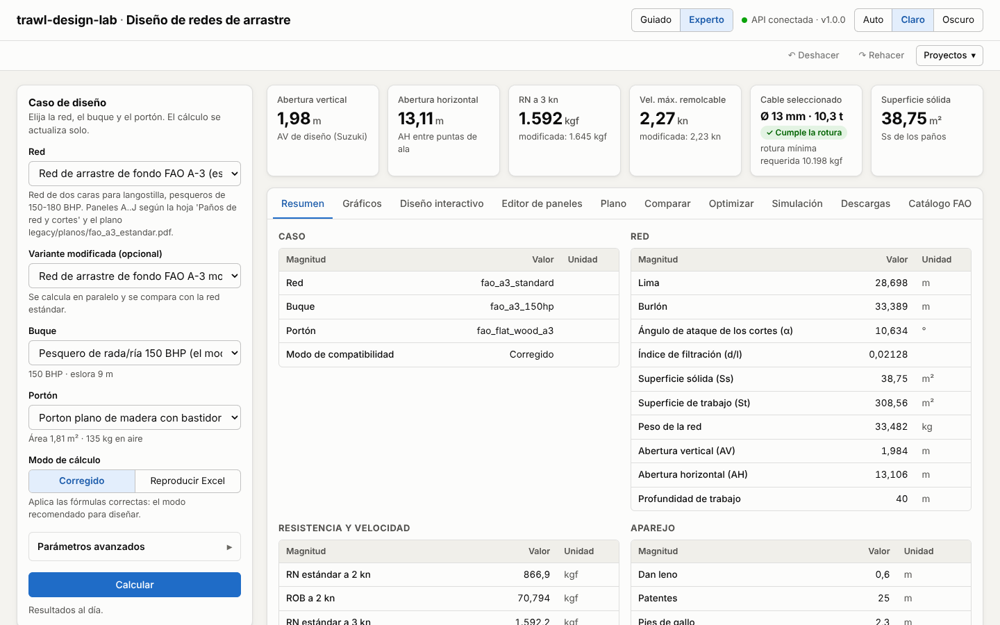

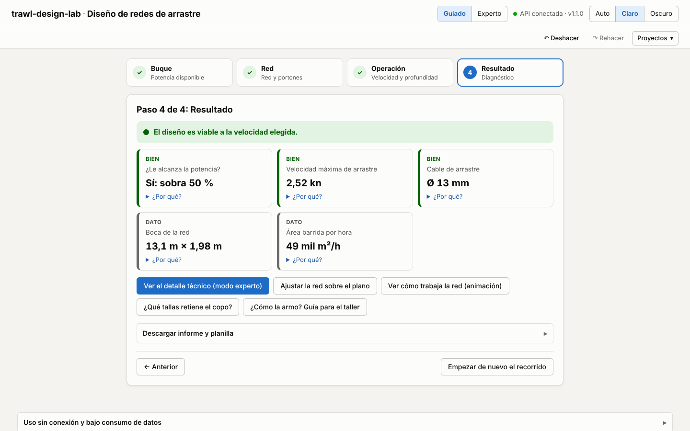

## Puesta en marcha en desarrollo

Se necesitan dos procesos: la API (Python) y el servidor de desarrollo de Vite (Node 22, npm 10).

```bash
# 1. API (desde la raíz del repositorio)
uv sync --all-extras --dev
uv run trawlkit serve --port 8000

# 2. Frontend (otra terminal)
cd web
npm ci
npm run dev            # http://localhost:5173
```

Por defecto el frontend llama a `http://127.0.0.1:8000` y la API acepta cualquier origen (CORS
`*`). Como alternativa, el servidor de Vite (y `vite preview`) expone un proxy `/api → :8000`:

```bash
VITE_API_URL=/api npm run dev
```

## Compilación y vista previa

```bash
cd web
npm run build          # tsc -b + vite build → web/dist/
npm run preview        # sirve dist/ en http://localhost:4173
```

`dist/` es estático: puede servirse desde cualquier servidor web. La URL de la API se fija en
tiempo de compilación con `VITE_API_URL`, y la ruta pública con `VITE_BASE` (por defecto `/`; para
servirla bajo una sub-ruta, p. ej. `VITE_BASE=/trawl-design-lab/app/`).

Al abrir, la app espera a que la API responda `GET /health` antes de pedir catálogos y calcular:
reintenta con esperas crecientes durante ~90 s (arranque en frío del servidor gratuito) y el
indicador de la cabecera pasa por «Conectando…», «Despertando la API (puede tardar hasta un
minuto)…» y «API conectada», o «API no disponible» con un botón «Reintentar»
(`src/lib/connection.ts`, `src/state/ConnectionProvider.tsx`).

El JavaScript inicial pesa unos 95 kB comprimidos (React aparte en su propio chunk); Recharts
(~110 kB comprimidos) se descarga sólo al abrir las pestañas «Gráficos», «Comparar» u
«Optimizar», y las pestañas «Optimizar» y «Simulación» se cargan también al abrirlas.

## Variables de entorno

| Variable | Dónde | Valor por defecto | Uso |
|---|---|---|---|
| `VITE_API_URL` | frontend (compilación) | `http://127.0.0.1:8000` | URL base de la API. `/api` usa el proxy de Vite. |
| `TRAWLKIT_API_TARGET` | `vite.config.ts` (dev/preview) | `http://127.0.0.1:8000` | Destino del proxy `/api`. |
| `VITE_BASE` | frontend (compilación) | `/` | Ruta pública de la app (`/trawl-design-lab/app/` en GitHub Pages). |
| `VITE_DOCS_URL` | frontend (compilación) | sin enlace | Enlace «Documentación» de la cabecera (`../` junto al libro). |
| `TRAWLKIT_CORS_ORIGINS` | API | `*` | Orígenes permitidos, separados por comas (p. ej. `https://redes.example.org,http://localhost:5173`). |
| `TRAWLKIT_MAX_SIM_SECONDS`, `TRAWLKIT_MAX_OPT_GRID`, `TRAWLKIT_ALLOW_REFINE` | API | `30`, `25`, permitido | Guardas de costo de `/simulate` y `/optimize` (ver {doc}`despliegue`). |

Hay un ejemplo en `web/.env.example`.

## Scripts npm

| Script | Qué hace |
|---|---|
| `dev` | Servidor de desarrollo con recarga en caliente. |
| `build` / `preview` | Compilación de producción y servidor de vista previa. |
| `lint` / `format` | ESLint (typescript-eslint, react-hooks) y Prettier. |
| `typecheck` | `tsc -b --noEmit`. |
| `test` | Pruebas unitarias y de componentes (Vitest + Testing Library, `fetch` simulado). |
| `test:e2e` | Pruebas de punta a punta con Playwright contra `vite preview` y la API real. |
| `gen:api` | Regenera `src/api/schema.d.ts` desde `web/openapi.json` (openapi-typescript). |

`web/openapi.json` es el contrato generado desde la API; no se edita a mano. Si la API cambia, se
regenera ese archivo y luego `npm run gen:api` (la CI verifica que `schema.d.ts` esté al día).

## Modos: guiado y experto

La app abre en el **modo guiado**, pensado para quien quiere una respuesta rápida sin conocer
todos los parámetros. Son cuatro pasos:

1. **Buque**: el buque del catálogo (potencia, eslora) y el tipo de hélice.
2. **Red**: la red, si se compara con otra y los portones. Se ofrecen las redes adecuadas a la
   potencia del buque elegido (la A-3 y las del catálogo FAO cuyo rango de ensayo, ±25 %, la
   incluye); «Ver todas» quita el filtro. Los borradores del catálogo no aparecen.
3. **Operación**: la velocidad de arrastre prevista (control deslizante) y la profundidad.
4. **Resultado**: un diagnóstico con semáforos. Dice si alcanza la potencia a esa velocidad
   (tiro disponible frente a la demanda de red, portones y cables, interpolados a la velocidad
   elegida; avisa con menos de 10 % de margen), la velocidad máxima de arrastre, si el cable cumple
   la carga de rotura, la boca de la red y el área barrida por hora (ancho de la boca × velocidad ×
   1852 m). Cada punto tiene un «¿Por qué?» en lenguaje llano y un enlace al capítulo del libro. Si
   la velocidad no se alcanza, ofrece probar con la máxima viable.

El **modo experto** es la interfaz completa (panel del caso, parámetros avanzados y todas las
pestañas). Los dos modos comparten el mismo caso: lo que se elige en uno aparece en el otro. El
conmutador «Guiado / Experto» está en la cabecera y el navegador recuerda la elección.

## Proyectos, deshacer y ayuda

- **Deshacer / Rehacer** (botones o `Ctrl+Z` / `Ctrl+Shift+Z` fuera de los campos de texto): cada
  cambio del caso entra al historial; los cambios seguidos al escribir un número se agrupan en un
  paso.
- **Proyectos**: guardar el caso con un nombre en este navegador (hasta 30), abrirlo o eliminarlo;
  exportarlo a un archivo `.trawl.json` para compartirlo y volver a importarlo. El archivo lleva un
  formato y una versión (`trawl-design-lab/project`, 1) y se valida al importarlo.
- **Ayuda contextual**: el botón «?» junto a un dato explica qué es, su unidad, su rango habitual y
  enlaza al capítulo del libro. Fuera del rango habitual se muestra un aviso, sin impedir el
  cálculo.

## Diseño interactivo y vista 3D

- **Diseño interactivo** (pestaña del modo experto; también desde el resultado del modo guiado con
  «Ajustar la red sobre el plano»): el plano de la red, dorso y vientre, dibujado desde
  `POST /design/layout`, que es la misma geometría de la lámina. Se toca un panel para
  seleccionarlo y aparecen tiradores: el borde inferior cambia el alto (mallas N) y las esquinas
  exteriores cambian los bordes hacia la bolsa y hacia la boca. El plano está a malla estirada
  (ancho = mallas × mallero; alto = N × mallero), así que el arrastre se convierte exactamente en
  mallas. Los paneles centrales son simétricos y cambian de a dos mallas. Con el teclado: Tab
  recorre los paneles, Enter selecciona, ↑/↓ cambian el alto, ←/→ el borde hacia la bolsa
  (Mayúsculas ×10), +/− hacen zoom y Esc cancela el arrastre o deselecciona.
- Al soltar, el caso se recalcula (el motor tarda unos 25 ms). La tira de indicadores muestra la
  resistencia a la velocidad prevista, la velocidad máxima, las aberturas, la superficie sólida y
  el peso, con la diferencia frente a la red de base (verde si mejora, rojo si empeora). La red
  original queda dibujada con línea discontinua y los paneles editados, resaltados. El inspector
  lateral permite escribir los valores o usar −/+, y cada cambio se deshace con Ctrl+Z.
- **Vista 3D** (pestaña «Simulación», opción «Vista 3D»): la forma simulada en WebGL (three.js,
  que se descarga sólo al abrirla). El paño se colorea por la tensión del hilo con una escala
  secuencial azul hasta el percentil 95. Se ven la lima y el burlón, las bridas y patentes, las
  boyas y el fondo. Se gira con el mouse o con el dedo, hay vistas de perspectiva, planta, perfil y
  frente, y se puede descargar un PNG. Sin WebGL quedan las proyecciones SVG.

## Lance progresivo: captura, fondo y portones acoplados

En la pestaña «Simulación», la vista **«Lance progresivo (captura y fondo)»** simula el lance
mientras entra la captura ({doc}`22_simulacion_realista`, `POST /simulate/haul`). Se eligen la
velocidad, la captura final (se reparte en 4 pasos desde 0), el tipo de captura (fija las
densidades), el tipo de fondo (con su rozamiento estimado) y si los portones quedan acoplados (su
separación sale del equilibrio con el cable hasta el buque). El resultado incluye:

- una frase con el efecto de la captura;
- cuatro gráficos chicos contra la captura: separación de portones (con la regla del motor de
  referencia), tiro en el buque (con la demanda del motor), aberturas horizontal y vertical;
- la tabla del lance (resistencias de la red y de la captura, roce, largo de la captura y
  diámetro del copo);
- la forma 3D de cada paso, coloreada por tensión del hilo o por el paño apoyado en el fondo.

En el modo guiado, el paso «Operación» pide el **tipo de fondo** (suma el roce de tren y portones a
la demanda del motor, y el diagnóstico lo explica) y la **captura esperada por lance** (valor
inicial del lance progresivo).

## Explorador animado: condiciones en funcionamiento

La tercera vista de «Simulación», **«Explorador animado»** ({doc}`23_mar_real`,
`POST /simulate/explore`), recorre una variable y anima cómo cambian la red, los portones y los
cables:

- **Variables**: captura en el copo, velocidad, cable filado, nivel de ensuciamiento, corriente a
  lo largo del rumbo y rozamiento del tren con el fondo. Se eligen el rango y la cantidad de
  estados (3–8), sobre un escenario base: velocidad, captura, fondo, ensuciamiento (red limpia,
  algas en las alas, medusas en el copo, ensuciamiento general), corriente, cable y resolución.
- **Animación 3D**: paño, relingas, bridas y patentes, portones (placas) y cables hasta el buque,
  con flechas rojas proporcionales al tiro de cada cable. El paño se colorea por tensión, por
  contacto con el fondo o por ensuciamiento. El encuadre es «red y portones» o «con cables hasta
  el buque». Entre los estados calculados la forma se interpola: la animación muestra cómo cambia
  el equilibrio, no una simulación dinámica en el tiempo.
- **Línea de tiempo**: reproducir/pausa, velocidad 0,5×–2×, paso a paso y deslizador. Con «reducir
  movimiento» del sistema no hay reproducción automática.
- **Tablero** sincronizado con el estado que se ve: separación de portones, aberturas, tiro,
  tensión y ángulo del cable, combustible (L/h y L/kg) y áreas barrida y en contacto con el
  fondo. Cada indicador muestra la diferencia con el primer estado: verde si mejora, rojo si
  empeora. Los gráficos contra la variable llevan un cursor en el estado actual.
- **Exportar**: PNG del cuadro actual y video WebM de la animación completa.

Se llega también desde el lance progresivo («Animar este lance en el explorador») y desde el
resultado del modo guiado («Ver cómo trabaja la red»).

## Mallas y selectividad

La cuarta vista de «Simulación», **«Mallas y selectividad»** ({doc}`24_malla_selectividad`,
`POST /simulate/selectivity`), simula el copo con la captura y el fondo elegidos y mide cada malla:

- **Copos a comparar**: el de la red (rombo), el mismo copo en **T90** y en **malla cuadrada**, del
  mismo ancho y largo relingados, con el mallero de la red o uno elegido.
- **Especies**: merluzas, bacalao, eglefino, cigala, langostino, platija y lenguado. La tabla da
  L50, SR y SF de cada copo; el gráfico, las curvas de retención de la especie elegida.
- **Mapa de mallas en 3D**: el paño coloreado por la apertura de la malla o por la talla máxima
  que pasa por ella.
- **Zoom por malla**: al hacer clic sobre el paño se abre un parche de mallas con su forma
  deformada, el hilo a escala, la luz y el área libre, y la sección de un pez de la talla elegida
  girada para pasar; indica si pasa o queda retenido.

El explorador animado acepta una especie: suma la apertura de malla del copo, L50 y SR al tablero
y a los gráficos, y el paño se puede colorear por apertura de malla. En el diseño interactivo, el
inspector del panel tiene la **orientación de la malla** (rombo, T90, cuadrada). Desde el resultado
del modo guiado, «¿Qué tallas retiene el copo?» abre esta vista con la captura y el fondo elegidos.

## Incertidumbre y calibración

La quinta vista de «Simulación», **«Incertidumbre y calibración»**
({doc}`25_incertidumbre_calibracion`), tiene dos partes:

- **Bandas de incertidumbre** (`POST /simulate/uncertainty`): con la velocidad, la captura, el
  fondo y la cantidad de muestras, simula muestras de los datos inciertos y muestra, por
  resultado, el nominal y la banda P10–P90 con las muestras sobre una escala común. Un gráfico de
  tornado indica qué dato mueve más el resultado elegido.
- **Calibración con mediciones** (`POST /sensors/parse`, `POST /simulate/calibrate`): se carga
  el CSV de los sensores del lance (o el registro de ejemplo sintético). La vista muestra las
  columnas reconocidas y los tramos estacionarios. Luego se eligen hasta 3 parámetros (C_N, C_T,
  sustentación y arrastre del portón, rozamientos) y se ajustan. El resultado muestra el error
  antes y después, los parámetros ajustados (marcados si quedan en el límite de su rango) y cada
  medición frente a la simulación. Con la red FAO A-3 estándar también se puede calibrar contra
  DynamiT.

## Catálogo FAO

La pestaña **«Catálogo FAO»** del modo experto ({doc}`33_catalogo_fao`) lista las redes
digitalizadas de documentos de la FAO:

- **Filtros**: texto, familia (fondo, pelágica), aparejo (portones, pareja), fuente y potencia
  del buque. Los borradores quedan ocultos salvo con «Mostrar borradores».
- **Insignias**: pareja, 4 paneles, pelágica, borrador y avisos o errores del validador.
- **Ficha de la red**: la fuente con enlace al documento y la barra de procedencia (transcripto,
  derivado, supuesto, Excel). Muestra también los avisos del validador y la tabla de procedencia
  valor por valor, filtrable por tipo y con la nota de cada supuesto.
- **«Usar esta red»**: la pone en el caso sin buque ni portón, y la API la calcula con su propio
  caso (buque de su potencia, portón y profundidad del plano). En el panel del caso, el buque y
  el portón muestran «Del plano» hasta que se elija uno.

## Componentes, lista de materiales y aportes

La pestaña **«Componentes»** ({doc}`34_componentes`) tiene cinco secciones:

- **Catálogo**: paño e hilo, cables, cabos, portones, boyas, cadenas y grilletes, con filtros por marca,
  región y «sólo genéricos». La ficha muestra la fuente, la procedencia valor por valor, las
  observaciones del validador y el genérico equivalente. «Usar en el caso» fija el componente
  (`warp_id`, `float_id`, `twine_id`, `chain_id`, el portón o los cabos de lima y burlón).
- **Lista de materiales** (`POST /design/bom`): qué comprar y cuánto, con el precio que el usuario
  carga por línea (queda en el navegador). Se descarga en CSV (separador «;» y coma decimal) o se
  imprime o guarda en PDF desde el navegador. Las líneas sin precio lo dicen y no suman cero.
  **Lista de precios** (Fase 19.2): «Importar precios» lee un CSV o XLSX (`POST /prices/parse`;
  clave = id del componente o de la línea, precio, moneda, unidad, fecha y fuente) y muestra las
  filas con error; «Exportar precios» baja la lista en CSV o XLSX (`POST /prices/export`) con las
  líneas sin precio vacías, como plantilla. Los precios se guardan también en el proyecto
  (campo `prices`), y abrir un proyecto los suma a los del navegador. Funciona sin conexión.
- **Armar con el catálogo** (`POST /optimize/components`): objetivo (menor resistencia, más área
  por litro o menor costo), región del puerto y «sólo genéricos». Muestra el armado recomendado,
  alternativas (una genérica si el mejor lleva marcas), las restricciones que no se cumplen y
  «Aplicar al caso».
- **Elegir portón** (Fase 19.3, `POST /doors/select`): lleva la superficie requerida por portón
  del caso a cada portón del catálogo con la regla de la superficie equivalente de Seafish
  ($A_2 = A_1 C_{L1}/C_{L2}$, más 10 % al pasar a más $C_L$; {doc}`15_portones_aparejo`). Filtros:
  tipo de portón, región del puerto y «sólo genéricos». La tabla da, por candidato, tipo,
  superficie, superficie requerida, margen, peso en aire (o «sin peso publicado»; «liviano» si pesa
  menos de la mitad del máximo del *Fisherman's Workbook*), ángulo de ataque recomendado y largo de
  las patas de gallo, con los avisos del motor; «Usar este portón» lo pone en el caso. «Reglas y
  fuentes» cita cada regla. Funciona sin conexión.
- **Aportar**: formulario por tipo, validado con `POST /components/check`. El aporte se guarda en el
  caso (también en el proyecto exportado) como «aporte, sin verificar» y se envía a la API en
  `components` sólo si se marca «Usar mis aportes». «Exportar» baja el JSON y «Proponer al
  catálogo» abre un *issue* con la plantilla `.github/ISSUE_TEMPLATE/componente.yml`.

## Lotes y flota

La pestaña **«Lotes y flota»** ({doc}`35_lotes_proyeccion`) calcula muchos casos de una vez:

- **Qué cargar**: flota de buques, redes (planos) o casos completos, con «Descargar plantilla»
  (XLSX con hoja de ayuda, o CSV).
- **Carga**: se arrastra o elige el archivo (.xlsx o .csv); `POST /batch/parse` devuelve las filas
  reconocidas y las observaciones por fila y columna. La flota se puede corregir en la tabla
  (nombre, potencia, eslora, profundidad, velocidad) o quitar buques antes de calcular.
- **Flota**: red a proyectar (catálogo FAO o la del caso), objetivo (la mayor red, menos trabajo
  por m² o el armado más barato con los precios de la lista de materiales), región del puerto,
  «sólo genéricos» y «armar con el catálogo».
- **Cálculo** por tramos (`POST /batch/run`) que entran en la guarda de costo del servidor, o de 10
  buques con el motor del teléfono, con barra de avance y «Cancelar».
- **Resultados**: semáforo por fila, filtro, «Abrir este caso» (pone la red escalada, el buque y
  el portón del lote en el caso; el panel lo indica con «Caso del lote») y descargas en XLSX,
  CSV, informe PDF y vista para imprimir (`POST /batch/export`).
- El último lote queda guardado en IndexedDB y vuelve al abrir la pestaña.

## Construcción: la guía para el taller

La pestaña **«Construcción»** ({doc}`36_construccion`, `POST /design/construction`) lleva el
diseño al taller:

- **Hoja de corte**: paño a comprar por calidad y, por pieza, las mallas, el ciclo de corte de
  cada costado explicado (los inferidos van marcados), por dónde empezar, el rectángulo de paño y
  el peso. Cada pieza tiene su casilla «cortado».
- **Armado paso a paso**: una unión por vez, en letra grande, con «Hecho, siguiente →» y el plano
  de la cara con los dos paños de la unión resaltados; debajo, la lista completa con casillas.
- **Montaje en relingas**: mallas por metro y coeficiente de armado de cada tramo de lima y burlón
  (con aviso si el cabo supera al paño), la línea de boyas sobre la lima y las zonas de lastre.
- **Cabos y cables**: largos terminados y de corte, con el sobrante por gaza ajustable.
- **Descargas**: guía en PDF (A4), planilla XLSX e «Imprimir guía» (HTML); sin conexión salen la
  planilla y la vista para imprimir.
- El avance (paños cortados, uniones hechas) queda guardado en el navegador por red y variante, y
  el resumen muestra el porcentaje del taller. En el modo guiado, el resultado ofrece «¿Cómo la
  armo? Guía para el taller».

## Economía de la operación

La pestaña **«Economía»** ({doc}`37_economia`, `POST /economics`) dice cuánto cuesta y cuánto deja
una marea con la red del caso:

- **Datos de la operación**: captura por hora y precio en playa, marea (lances, duración,
  maniobras, navegación, mareas por año), gasoil y lubricante, tripulación (a la parte, a jornal o
  sin contar), red y aparejo (costo, vida útil, reparación) y otros gastos. Los precios empiezan en
  blanco y se guardan en el navegador; las constantes de ingeniería muestran su valor por defecto.
- **Resumen** a la velocidad de mayor margen (margen por marea y por año, costo por kg, gasoil y
  precio de equilibrio) y aviso de los datos que faltan.
- **Por velocidad**: ingreso, costo y margen con la franja donde el buque remolca con reserva, la
  tabla por velocidad y el reparto del costo de la marea.
- **Comparar redes**: otra red del catálogo en el mismo buque, con ahorro por año y repago de la
  red nueva (`POST /economics/compare`).
- En **Lotes y flota**, «Sumar la economía de la marea» agrega gasoil, captura, costo por kg y
  margen por buque. En el modo guiado, «¿Cuánto deja la marea?».

## Aula UTN

El tercer modo de la cabecera, **«Aula UTN»** (Fase 17, {doc}`38_docentes`), tiene dos partes:

- **Práctica libre** (sin cuenta, también sin conexión): el banco de ejercicios
  (`GET /teaching/exercises`) filtrado por capítulo y nivel; cada ejercicio se abre con datos
  nuevos o con los del libro, con pistas, corrección por respuesta (`POST /teaching/grade`) y la
  explicación. Los **laboratorios** se empiezan desde la misma lista: cargan su caso de partida y
  abren el modo experto con un panel (`components/classroom/LabPanel.tsx`) que muestra el paso, lleva
  a su pestaña («Ir a…»), comprueba el caso abierto (`POST /teaching/labs/check`) y corrige las
  preguntas. El avance queda en `localStorage` (`trawl-design-lab:lab:v1`).
- **Cursos** (en línea, con el aula habilitada en el servidor): ingreso y alta con código de curso o
  de invitación; la sesión es un token *bearer* guardado en `trawl-design-lab:aula:v1`. El alumno ve
  las tareas abiertas de sus cursos, resuelve cada ejercicio con sus propios datos y entrega; los
  laboratorios de una tarea se hacen con el panel y al terminar se entregan con el caso de cada
  paso. El docente crea cursos y tareas eligiendo ejercicios y laboratorios del banco, comparte el
  código, ve la planilla de notas, abre cada entrega para ponerle nota y comentario, resetea
  contraseñas de sus alumnos y descarga las notas (Excel) y los enunciados o la clave de cada alumno
  (PDF). La administración genera las invitaciones para docentes.

Sin la base de datos en el servidor, «Cursos» lo avisa y la práctica libre sigue funcionando.

## Idioma y unidades

La cabecera tiene dos selectores más: **ES/EN** (idioma) y **Métrico/Imperial** (unidades).
Los dos se recuerdan en el navegador; la primera vez el idioma sale del navegador (inglés si no
es español).

- **Idioma.** Los textos de la app viven en `web/src/i18n/es/*.ts` (la fuente) y
  `web/src/i18n/en/*.ts`, tipado contra el español: si al inglés le falta una clave, `npm run
  typecheck` falla. La app manda `lang=en` a la API y al motor del teléfono, así las notas, los
  avisos, los ejercicios, los laboratorios y los informes descargados llegan en el mismo idioma.
  Los nombres de redes, buques y portones son datos y no se traducen. Los números usan coma o
  punto decimal según el idioma; los campos aceptan los dos.
- **Unidades.** El motor calcula siempre en métrico. En imperial la app sólo convierte para
  mostrar y para leer lo que se escribe (m → ft, mm → in, kgf → lbf, kg → lb, m² → ft²,
  L → gal, $/L → $/gal, $/kg → $/lb); lo que se guarda en el proyecto y se manda al motor sigue
  en métrico. Las mallas quedan en mm con la pulgada entre paréntesis, como en el oficio. Los
  ejercicios del aula se corrigen en las unidades de su enunciado.

## Accesibilidad

La app apunta a WCAG 2.1 AA y lo prueba en cada cambio (`web/e2e/a11y.spec.ts`):

- **axe** (`@axe-core/playwright`) revisa el modo guiado, el aula y las quince pestañas del modo
  experto, en tema claro y oscuro y en español e inglés; también los resultados ya calculados
  (simulación 3D, optimización) y el panel de un laboratorio en curso. La prueba falla con
  cualquier violación seria o crítica.
- **Teclado**: una prueba recorre el modo guiado completo sin mouse (Tab, flechas en las opciones
  y en las pestañas, Enter) y otra resuelve y corrige un ejercicio del aula.
- **Foco**: al cambiar de paso en un laboratorio el foco va al título del paso; la revisión de
  una entrega toma el foco, se cierra con Esc y lo devuelve al botón que la abrió. Las tablas con
  scroll propio se pueden enfocar para recorrerlas con el teclado. Los resultados de las
  comprobaciones se anuncian (`role="status"` y `role="alert"`).

Para correr sólo estas pruebas: `npx playwright test e2e/a11y.spec.ts`.

## Uso sin conexión y bajo consumo de datos

La app se instala como aplicación (PWA, `vite-plugin-pwa`): el *service worker* guarda la app y,
al pulsar **«Preparar uso sin conexión»** (panel al pie de la página), descarga una sola vez
Pyodide 0.29.5, numpy, pydantic, pyyaml y la *wheel* de `trawlkit` (≈ 15 MB) en la caché
`trawl-offline-v1`. Desde entonces:

- si falla la red, el cliente de la API (`src/api/client.ts`) atiende el pedido con el motor del
  teléfono (`src/engine/`: un *Web Worker* con `trawlkit.api.offline`), con las mismas rutas y
  respuestas; el indicador dice «Sin conexión · motor del teléfono»;
- «Siempre en el teléfono» usa el motor local aunque haya señal (ahorra datos);
- desde la Fase 18 también corren en el teléfono la simulación (forma, lance, explorador,
  selectividad, incertidumbre y calibración), los planos SVG, el informe HTML y XLSX y los
  registros de sensores, con guardas de costo más bajas que las del servidor
  (`offline.PHONE_LIMITS`): una simulación demasiado grande pide bajar la resolución en lugar de
  colgar el teléfono, y «Cancelar» detiene el motor (el próximo pedido lo vuelve a cargar);
- los PDF, el refinamiento de la optimización (scipy) y los cursos del aula responden 503 con un
  mensaje que lo explica.

La *wheel* se construye en la CI y en `docs.yml` (`uv build --wheel` y
`tools/offline_bundle.py`, que la copia a `web/public/py/<hash>/` con su `manifest.json`); sin ese
paso (desarrollo local) el botón avisa que la compilación no trae el motor. El **modo de bajo
consumo de datos** oculta «Diseño interactivo» y «Simulación», que descargan three.js.

## Funcionalidades

- **Caso de diseño** (panel izquierdo; arriba en móvil): red, variante modificada opcional, buque,
  portón, modo *corregido* / *reproducir Excel* y «Parámetros avanzados» generados desde
  `GET /params` (valor por defecto como marcador, celda del Excel como ayuda, restablecer). El caso
  se recalcula solo (con 450 ms de espera) o con «Calcular»; los errores 422/404 de la API se
  muestran con su `detail`. El último caso se guarda en `localStorage`.
- **KPI**: abertura vertical y horizontal, RN a 3 kn, velocidad máxima remolcable, cable
  seleccionado (con aviso si no cumple la rotura mínima) y superficie sólida.
- **Resumen**: todas las magnitudes de `summary` con etiqueta y unidad
  (`src/lib/labels.ts`, espejo de `trawlkit.report.labels.SUMMARY_LABELS`).
- **Gráficos** (Recharts): tiro disponible por método vs resistencia total con la ventana
  remolcable sombreada y la velocidad máxima; RN por los 13 métodos con el de diseño resaltado;
  composición de la resistencia total (red, boyas, cables, portones) a una velocidad elegida;
  DPA y AV de Fridman. Cada gráfico tiene leyenda, tooltip y «Ver tabla de datos».
- **Editor de paneles**: tabla editable (mallero, Ø hilo, mallas boca/bolsa/alto, U1, cantidad)
  con validación; las celdas editadas se marcan y la red se envía en línea como `NetSpec`.
- **Plano**: SVG de `POST /design/plan` (lámina / escala real, estándar / modificada) con zoom y
  desplazamiento (rueda, arrastre, pellizco o teclado) y descarga.
- **Comparar**: fija el resultado actual como «A» y lo compara con el caso en vivo «B»
  (diferencia absoluta y porcentual, curvas superpuestas).
- **Optimizar**: objetivo (área barrida, volumen o energía), reserva de tiro, rangos de escala y
  velocidad, tamaño de la malla, portón y refinado opcional por evolución diferencial
  (`POST /optimize`, ver {doc}`20_optimizacion`). Muestra el mejor diseño (escala, velocidad, AH,
  AV, área barrida por hora, R_T, F_T, margen y cada restricción con OK/NO), el mapa de
  factibilidad escala × velocidad (celdas factibles coloreadas por el objetivo, no factibles
  rayadas) y el frente de Pareto. «Usar este diseño» pide la red escalada
  (`POST /optimize/scaled-net`, también la modificada si hay), la aplica al caso como red en línea
  y vuelve al Resumen; «Volver a la red del catálogo» la quita.
- **Simulación** (experimental): hasta tres velocidades y resolución rápida (3) o normal (6);
  `POST /simulate` devuelve la forma de equilibrio y se muestran planta, perfil y frente de cada
  velocidad (con el mismo visor con zoom del plano), una tabla de AH, AV y resistencia simuladas
  frente al motor empírico y, para la red FAO A-3 estándar, frente a DynamiT, con diferencias
  porcentuales, y una nota sobre la brecha de resistencia (ver {doc}`21_simulacion`).
- **Descargas**: informe HTML, PDF y XLSX (`POST /design/report`) y el JSON del resultado.
- **Notas y erratas**: notas del cálculo y tratamiento de cada errata en el modo actual.

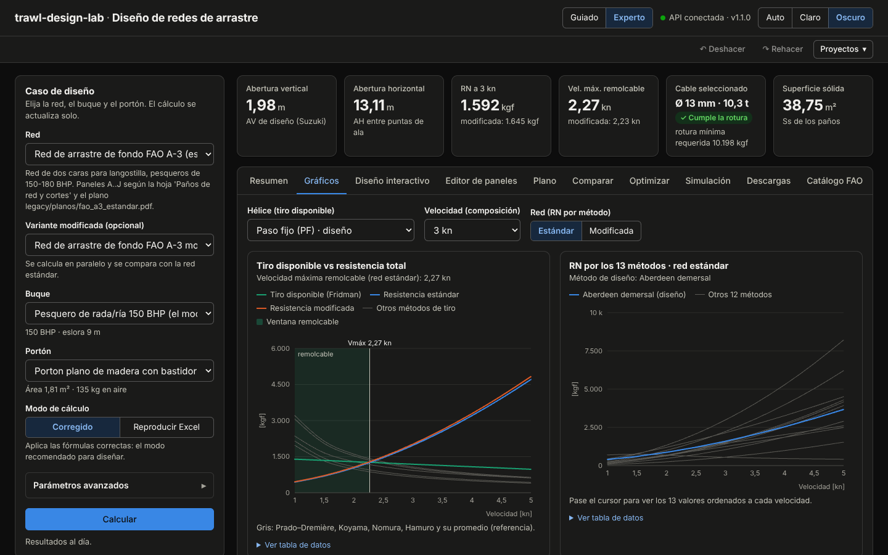

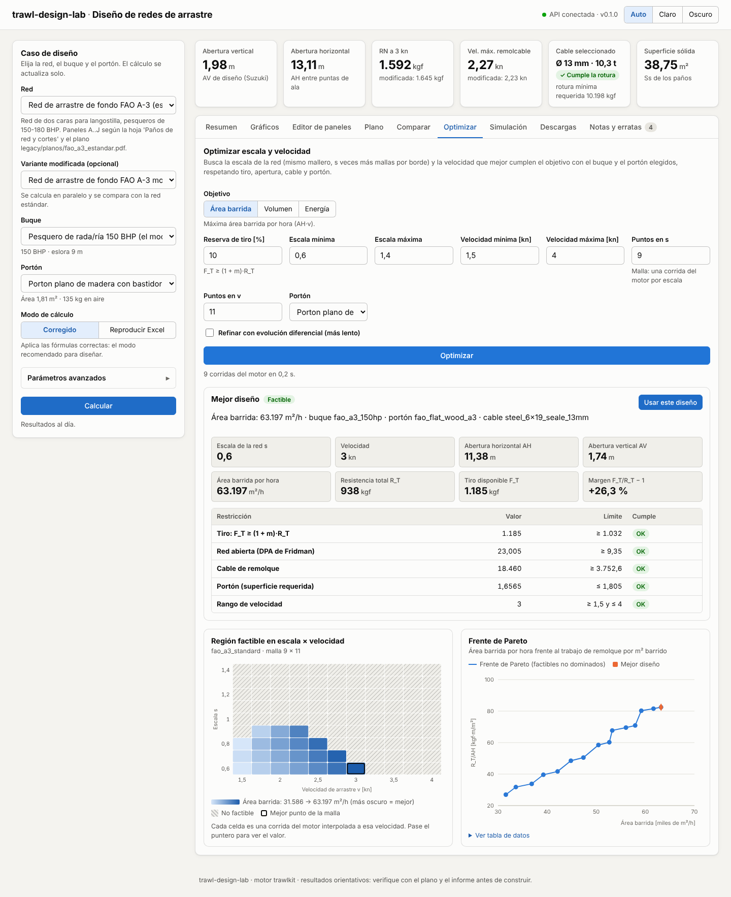

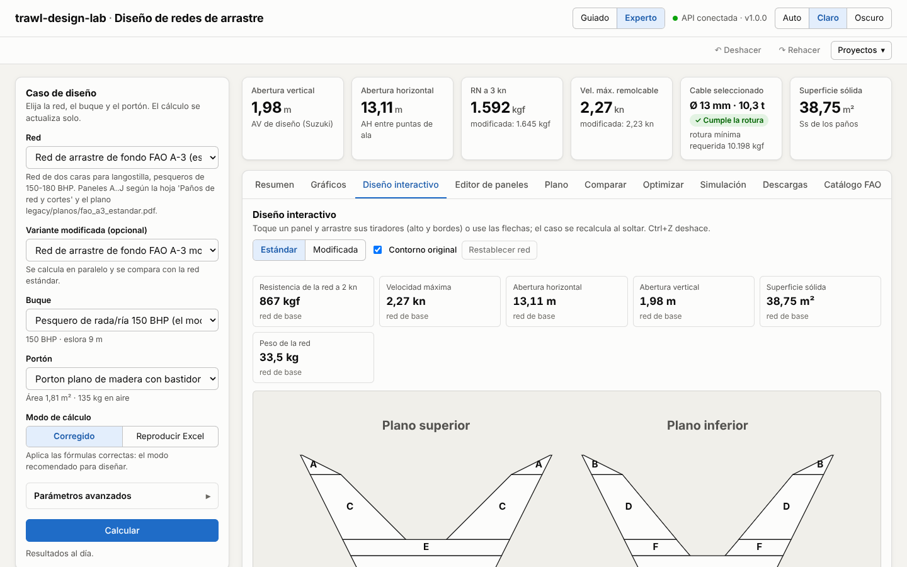

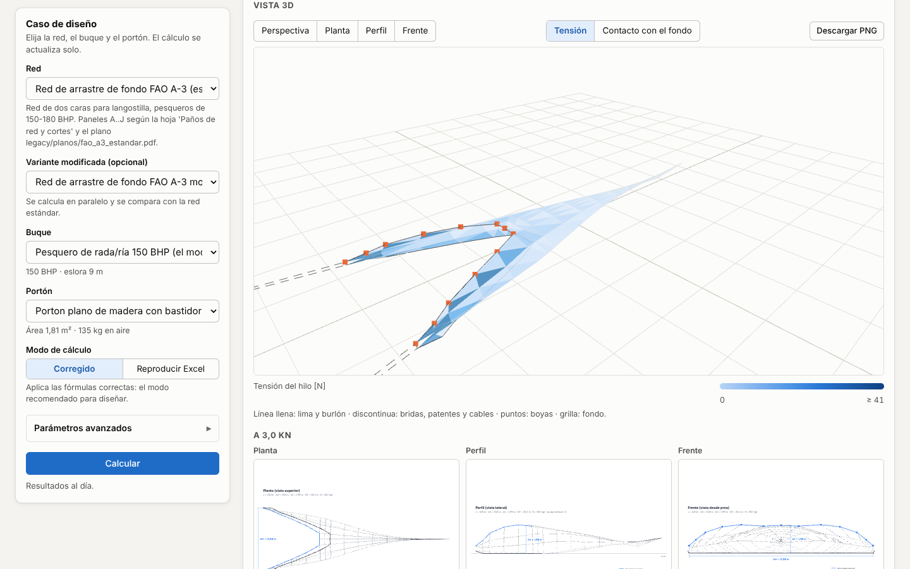

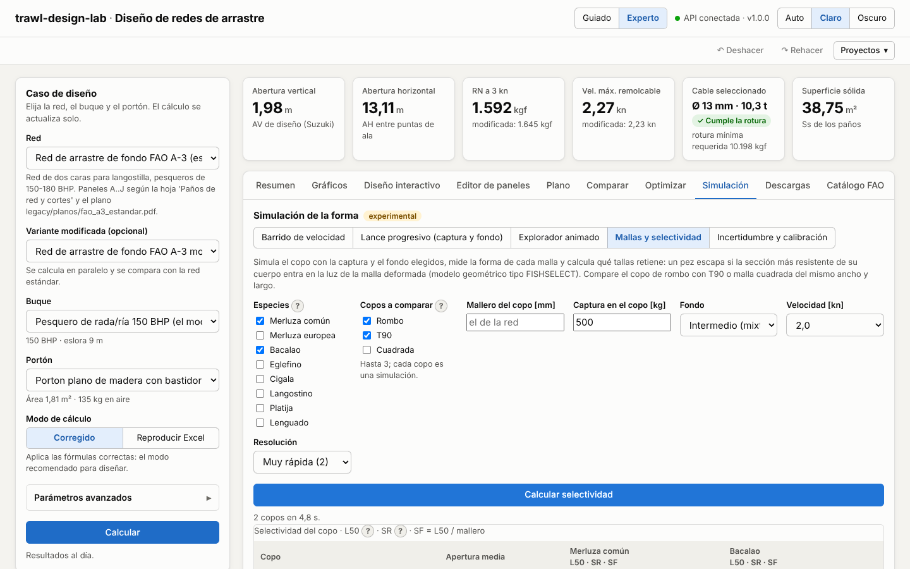

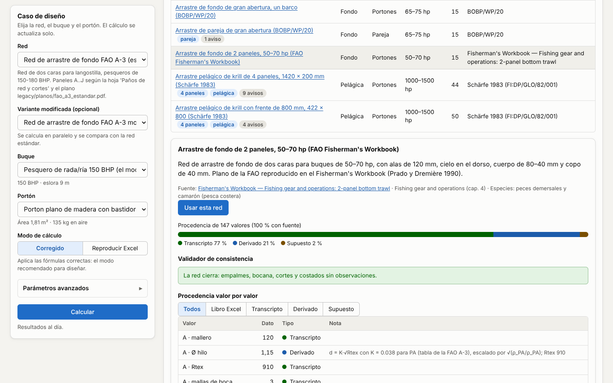

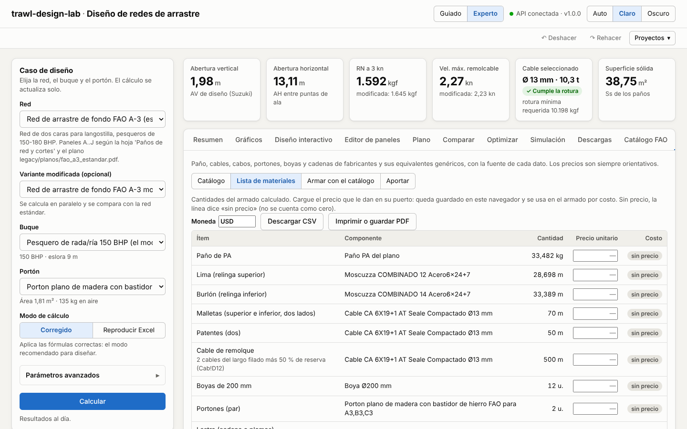

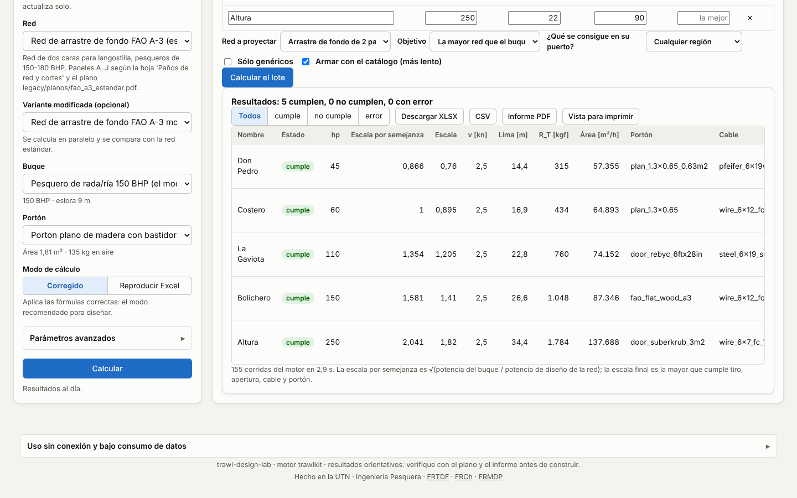

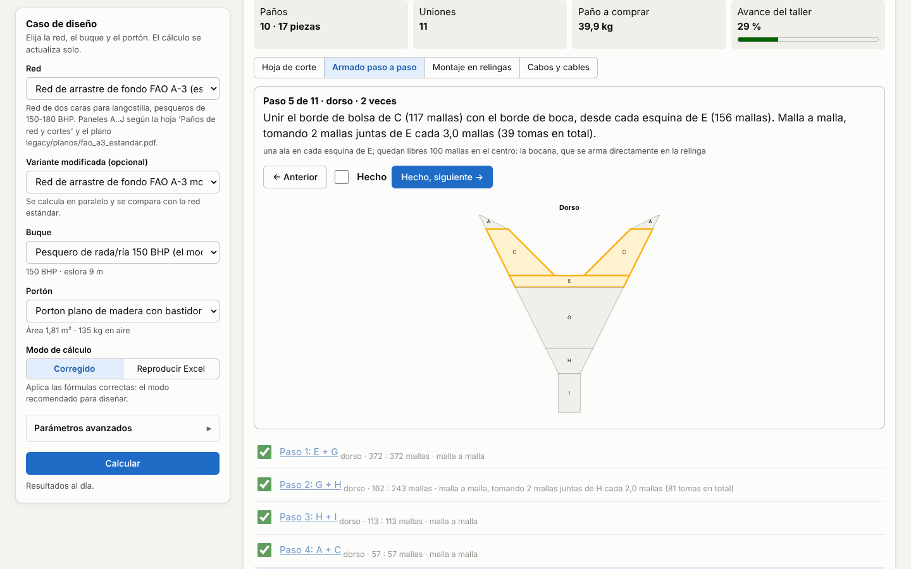

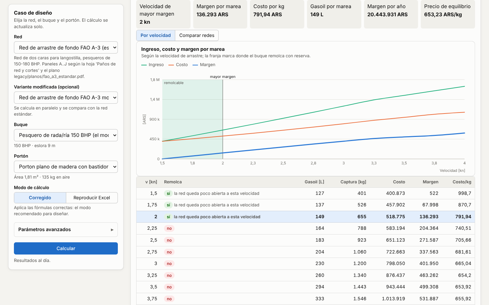

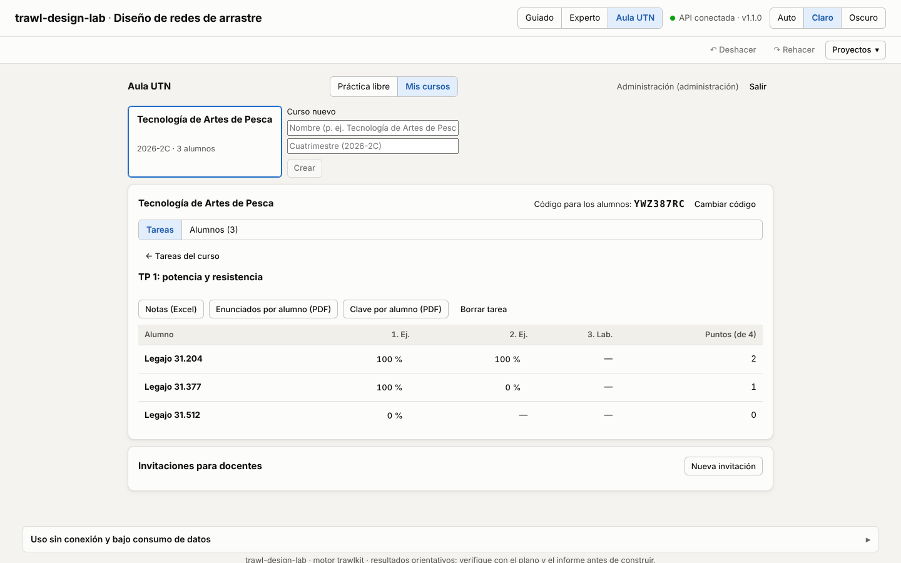

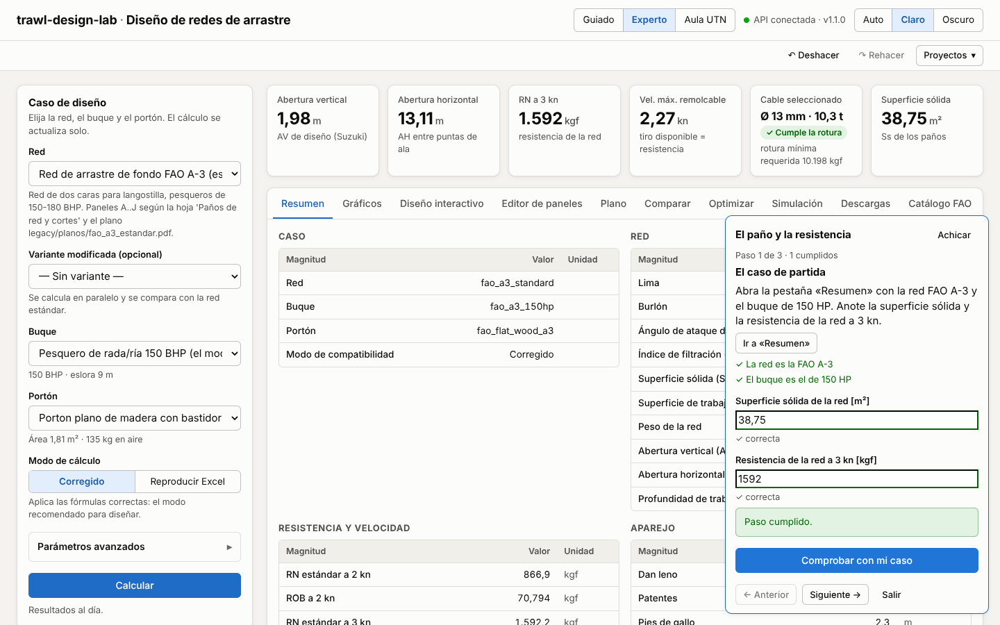

## Arquitectura

```
web/
├── openapi.json              contrato de la API (generado, no editar)
├── src/
│   ├── api/                  schema.d.ts (generado), client.ts (fetch tipado), result.ts
│   ├── lib/                  formato por idioma, unidades, etiquetas, parámetros, paneles, series, diff, tema
│   ├── state/                ConnectionProvider (espera a /health); CaseProvider: caso, catálogos, /design
│   ├── components/           panel del caso, KPI, pestañas, editor, plano, comparación…
│   │   └── charts/           gráficos Recharts (carga diferida)
│   └── test/                 fixtures grabados de la API y doble de fetch
├── e2e/                      pruebas Playwright
└── docs/screenshots/         capturas usadas en esta página
```

- **Estado**: un único contexto (`CaseProvider`) guarda el caso (ids, modo, parámetros como texto,
  ediciones de paneles) y arma el `DesignRequest`. Los datos remotos se piden con TanStack Query;
  el resultado anterior se mantiene atenuado mientras llega el nuevo.
- **Paneles editados**: el motor usa los extras `meshes_a`/`meshes_b` (bordes T1/T2 del Excel)
  cuando existen; el editor los actualiza en espejo de `meshes_top`/`meshes_bottom`.
- **Estilos**: un único `styles.css` con variables CSS para tema claro y oscuro (automático según
  el sistema, o forzado con el conmutador de la cabecera). La paleta de los gráficos está validada
  para daltonismo en ambos temas.
- **Accesibilidad**: etiquetas en todos los campos, pestañas WAI-ARIA con flechas, foco visible,
  errores asociados con `aria-describedby`, tablas de datos para cada gráfico; diseño usable desde
  375 px de ancho.

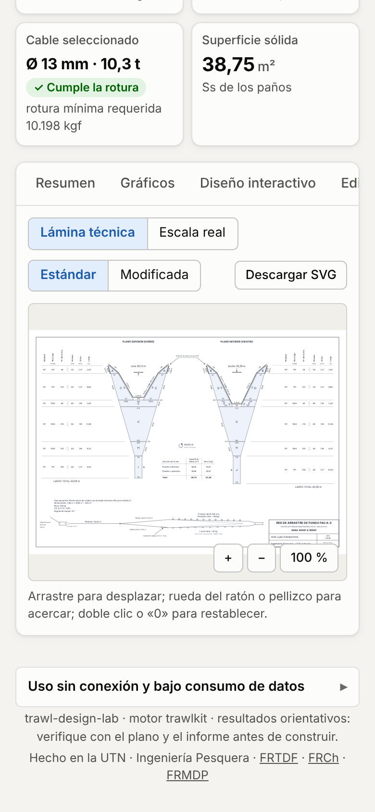

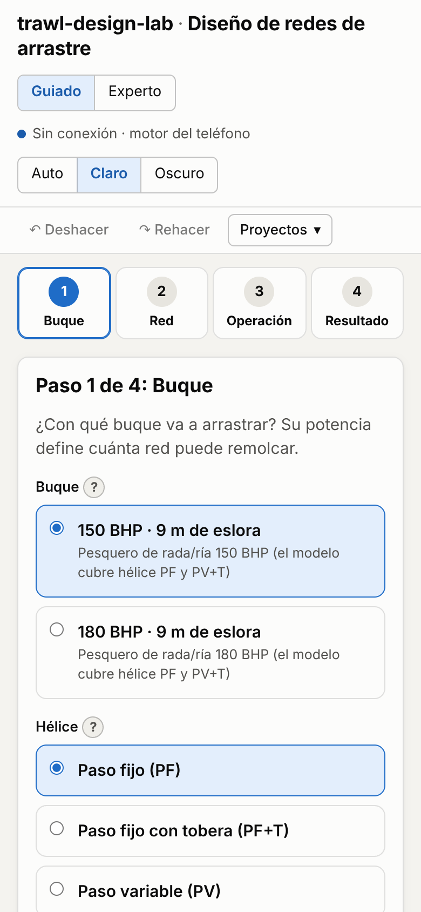

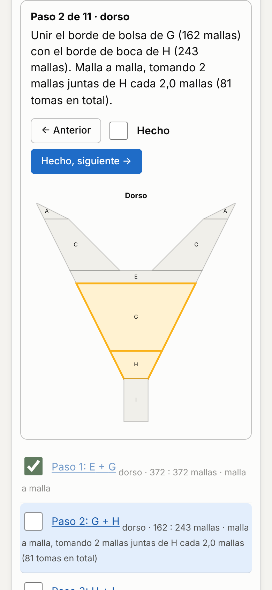

## Pruebas

```bash
cd web
npm test               # Vitest (pruebas unitarias)
npm run test:e2e       # Playwright (de punta a punta)
```

Playwright levanta la API (`uv run trawlkit serve`, requiere `uv sync --all-extras`) y
`vite preview` si no están corriendo, y reutiliza los que ya estén activos en local. Usa Chromium;
en una máquina nueva instalarlo con `npx playwright install chromium`. En la CI (job `web` de
`.github/workflows/ci.yml`) se corren lint, Prettier, typecheck, pruebas unitarias, build y E2E.

Además, `scripts/pyodide-parity.mjs` corre `trawlkit.api.offline` dentro de Pyodide en Node y
compara las respuestas con las de CPython (`tools/offline_expected.py`, tolerancia relativa
1e-9), y `e2e/offline.spec.ts` instala la PWA, prepara el motor, corta la red con
`context.setOffline(true)` y calcula, arma la lista de materiales y valida un aporte.

## Capturas

Las capturas de esta página y del README están en `web/docs/screenshots/` y se regeneran con
`npm run screenshots` (`screenshots/capture.spec.ts`, con el mismo arranque que las E2E: API local y
`vite preview`). Son de escritorio a 1440 × 900 (`escritorio-*`, `guiado-diagnostico`) y de
teléfono a 390 × 844 (`movil-*`); la de `movil-sin-conexion` prepara el motor del teléfono y corta
la red antes de capturar.
