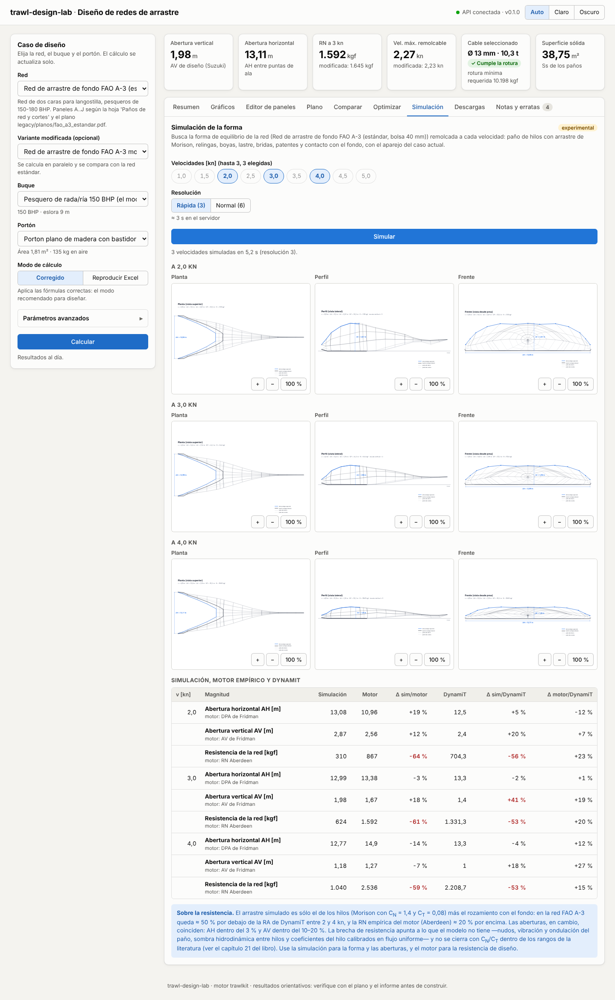

# Interfaz web

`web/` contiene la aplicación de página única **trawl-design-lab · Diseño de redes de arrastre**
(React 19 + Vite + TypeScript estricto). Consume la API HTTP de `trawlkit` y permite armar un caso
de diseño, editar los paneles de la red, ver resultados, gráficos y planos, comparar variantes y
descargar los informes. Toda la interfaz está en español y los números usan coma decimal
(`Intl.NumberFormat('es-AR')`).

**Probar en línea:** <https://arielgiamportone.github.io/trawl-design-lab/app/> (vista previa
publicada con este libro; cómo se despliega y sus limitaciones en {doc}`despliegue`).


## Puesta en marcha en desarrollo

Se necesitan dos procesos: la API (Python) y el servidor de desarrollo de Vite (Node 22, npm 10).

```bash
# 1. API (desde la raíz del repositorio)
uv sync --all-extras --dev
uv run trawlkit serve --port 8000

# 2. Frontend (otra terminal)
cd web
npm ci
npm run dev            # http://localhost:5173
```

Por defecto el frontend llama a `http://127.0.0.1:8000` y la API acepta cualquier origen (CORS
`*`). Como alternativa, el servidor de Vite (y `vite preview`) expone un proxy `/api → :8000`:

```bash
VITE_API_URL=/api npm run dev
```

## Compilación y vista previa

```bash
cd web
npm run build          # tsc -b + vite build → web/dist/
npm run preview        # sirve dist/ en http://localhost:4173
```

`dist/` es estático: puede servirse desde cualquier servidor web. La URL de la API se fija en
tiempo de compilación con `VITE_API_URL`, y la ruta pública con `VITE_BASE` (por defecto `/`; para
servirla bajo una sub-ruta, p. ej. `VITE_BASE=/trawl-design-lab/app/`).

Al abrir, la app espera a que la API responda `GET /health` antes de pedir catálogos y calcular:
reintenta con esperas crecientes durante ~90 s (arranque en frío del servidor gratuito) y el
indicador de la cabecera pasa por «Conectando…», «Despertando la API (puede tardar hasta un
minuto)…» y «API conectada», o «API no disponible» con un botón «Reintentar»
(`src/lib/connection.ts`, `src/state/ConnectionProvider.tsx`).

El JavaScript inicial pesa unos 95 kB comprimidos (React aparte en su propio chunk); Recharts
(~110 kB comprimidos) se descarga sólo al abrir las pestañas «Gráficos», «Comparar» u
«Optimizar», y las pestañas «Optimizar» y «Simulación» se cargan también al abrirlas.

## Variables de entorno

| Variable | Dónde | Valor por defecto | Uso |
|---|---|---|---|
| `VITE_API_URL` | frontend (compilación) | `http://127.0.0.1:8000` | URL base de la API. `/api` usa el proxy de Vite. |
| `TRAWLKIT_API_TARGET` | `vite.config.ts` (dev/preview) | `http://127.0.0.1:8000` | Destino del proxy `/api`. |
| `VITE_BASE` | frontend (compilación) | `/` | Ruta pública de la app (`/trawl-design-lab/app/` en GitHub Pages). |
| `VITE_DOCS_URL` | frontend (compilación) | sin enlace | Enlace «Documentación» de la cabecera (`../` junto al libro). |
| `TRAWLKIT_CORS_ORIGINS` | API | `*` | Orígenes permitidos, separados por comas (p. ej. `https://redes.example.org,http://localhost:5173`). |
| `TRAWLKIT_MAX_SIM_SECONDS`, `TRAWLKIT_MAX_OPT_GRID`, `TRAWLKIT_ALLOW_REFINE` | API | `30`, `25`, permitido | Guardas de costo de `/simulate` y `/optimize` (ver {doc}`despliegue`). |

Hay un ejemplo en `web/.env.example`.

## Scripts npm

| Script | Qué hace |
|---|---|
| `dev` | Servidor de desarrollo con recarga en caliente. |
| `build` / `preview` | Compilación de producción y servidor de vista previa. |
| `lint` / `format` | ESLint (typescript-eslint, react-hooks) y Prettier. |
| `typecheck` | `tsc -b --noEmit`. |
| `test` | Pruebas unitarias y de componentes (Vitest + Testing Library, `fetch` simulado). |
| `test:e2e` | Pruebas de punta a punta con Playwright contra `vite preview` y la API real. |
| `gen:api` | Regenera `src/api/schema.d.ts` desde `web/openapi.json` (openapi-typescript). |

`web/openapi.json` es el contrato generado desde la API; no se edita a mano. Si la API cambia, se
regenera ese archivo y luego `npm run gen:api` (la CI verifica que `schema.d.ts` esté al día).

## Modos: guiado y experto

La app abre en el **modo guiado**, pensado para quien quiere una respuesta rápida sin conocer
todos los parámetros. Son cuatro pasos:

1. **Buque**: el buque del catálogo (potencia, eslora) y el tipo de hélice.
2. **Red**: la red, si se compara con otra y los portones.
3. **Operación**: la velocidad de arrastre prevista (control deslizante) y la profundidad.
4. **Resultado**: un diagnóstico con semáforos. Dice si alcanza la potencia a esa velocidad
   (tiro disponible frente a la demanda de red, portones y cables, interpolados a la velocidad
   elegida; avisa con menos de 10 % de margen), la velocidad máxima de arrastre, si el cable cumple
   la carga de rotura, la boca de la red y el área barrida por hora (ancho de la boca × velocidad ×
   1852 m). Cada punto tiene un «¿Por qué?» en lenguaje llano y un enlace al capítulo del libro. Si
   la velocidad no se alcanza, ofrece probar con la máxima viable.

El **modo experto** es la interfaz completa (panel del caso, parámetros avanzados y todas las
pestañas). Los dos modos comparten el mismo caso: lo que se elige en uno aparece en el otro. El
conmutador «Guiado / Experto» está en la cabecera y el navegador recuerda la elección.

## Proyectos, deshacer y ayuda

- **Deshacer / Rehacer** (botones o `Ctrl+Z` / `Ctrl+Shift+Z` fuera de los campos de texto): cada
  cambio del caso entra al historial; los cambios seguidos al escribir un número se agrupan en un
  paso.
- **Proyectos**: guardar el caso con un nombre en este navegador (hasta 30), abrirlo o eliminarlo;
  exportarlo a un archivo `.trawl.json` para compartirlo y volver a importarlo. El archivo lleva un
  formato y una versión (`trawl-design-lab/project`, 1) y se valida al importarlo.
- **Ayuda contextual**: el botón «?» junto a un dato explica qué es, su unidad, su rango habitual y
  enlaza al capítulo del libro. Fuera del rango habitual se muestra un aviso, sin impedir el
  cálculo.

## Diseño interactivo y vista 3D

- **Diseño interactivo** (pestaña del modo experto; también desde el resultado del modo guiado con
  «Ajustar la red sobre el plano»): el plano de la red, dorso y vientre, dibujado desde
  `POST /design/layout`, que es la misma geometría de la lámina. Se toca un panel para
  seleccionarlo y aparecen tiradores: el borde inferior cambia el alto (mallas N) y las esquinas
  exteriores cambian los bordes hacia la bolsa y hacia la boca. El plano está a malla estirada
  (ancho = mallas × mallero; alto = N × mallero), así que el arrastre se convierte exactamente en
  mallas. Los paneles centrales son simétricos y cambian de a dos mallas. Con el teclado: Tab
  recorre los paneles, Enter selecciona, ↑/↓ cambian el alto, ←/→ el borde hacia la bolsa
  (Mayúsculas ×10), +/− hacen zoom y Esc cancela el arrastre o deselecciona.
- Al soltar, el caso se recalcula (el motor tarda unos 25 ms). La tira de indicadores muestra la
  resistencia a la velocidad prevista, la velocidad máxima, las aberturas, la superficie sólida y
  el peso, con la diferencia frente a la red de base (verde si mejora, rojo si empeora). La red
  original queda dibujada con línea discontinua y los paneles editados, resaltados. El inspector
  lateral permite escribir los valores o usar −/+, y cada cambio se deshace con Ctrl+Z.
- **Vista 3D** (pestaña «Simulación», opción «Vista 3D»): la forma simulada en WebGL (three.js,
  que se descarga sólo al abrirla). El paño se colorea por la tensión del hilo con una escala
  secuencial azul hasta el percentil 95. Se ven la lima y el burlón, las bridas y patentes, las
  boyas y el fondo. Se gira con el mouse o con el dedo, hay vistas de perspectiva, planta, perfil y
  frente, y se puede descargar un PNG. Sin WebGL quedan las proyecciones SVG.

## Lance progresivo: captura, fondo y portones acoplados

En la pestaña «Simulación», la vista **«Lance progresivo (captura y fondo)»** simula el lance
mientras entra la captura ({doc}`22_simulacion_realista`, `POST /simulate/haul`). Se eligen la
velocidad, la captura final (se reparte en 4 pasos desde 0), el tipo de captura (fija las
densidades), el tipo de fondo (con su rozamiento estimado) y si los portones quedan acoplados (su
separación sale del equilibrio con el cable hasta el buque). El resultado incluye:

- una frase con el efecto de la captura;
- cuatro gráficos chicos contra la captura: separación de portones (con la regla del motor de
  referencia), tiro en el buque (con la demanda del motor), aberturas horizontal y vertical;
- la tabla del lance (resistencias de la red y de la captura, roce, largo de la captura y
  diámetro del copo);
- la forma 3D de cada paso, coloreada por tensión del hilo o por el paño apoyado en el fondo.

En el modo guiado, el paso «Operación» pide el **tipo de fondo** (suma el roce de tren y portones a
la demanda del motor, y el diagnóstico lo explica) y la **captura esperada por lance** (valor
inicial del lance progresivo).

## Explorador animado: condiciones en funcionamiento

La tercera vista de «Simulación», **«Explorador animado»** ({doc}`23_mar_real`,
`POST /simulate/explore`), recorre una variable y anima cómo cambian la red, los portones y los
cables:

- **Variables**: captura en el copo, velocidad, cable filado, nivel de ensuciamiento, corriente a
  lo largo del rumbo y rozamiento del tren con el fondo. Se eligen el rango y la cantidad de
  estados (3–8), sobre un escenario base: velocidad, captura, fondo, ensuciamiento (red limpia,
  algas en las alas, medusas en el copo, ensuciamiento general), corriente, cable y resolución.
- **Animación 3D**: paño, relingas, bridas y patentes, portones (placas) y cables hasta el buque,
  con flechas rojas proporcionales al tiro de cada cable. El paño se colorea por tensión, por
  contacto con el fondo o por ensuciamiento. El encuadre es «red y portones» o «con cables hasta
  el buque». Entre los estados calculados la forma se interpola: la animación muestra cómo cambia
  el equilibrio, no una simulación dinámica en el tiempo.
- **Línea de tiempo**: reproducir/pausa, velocidad 0,5×–2×, paso a paso y deslizador. Con «reducir
  movimiento» del sistema no hay reproducción automática.
- **Tablero** sincronizado con el estado que se ve: separación de portones, aberturas, tiro,
  tensión y ángulo del cable, combustible (L/h y L/kg) y áreas barrida y en contacto con el
  fondo. Cada indicador muestra la diferencia con el primer estado: verde si mejora, rojo si
  empeora. Los gráficos contra la variable llevan un cursor en el estado actual.
- **Exportar**: PNG del cuadro actual y video WebM de la animación completa.

Se llega también desde el lance progresivo («Animar este lance en el explorador») y desde el
resultado del modo guiado («Ver cómo trabaja la red»).

## Mallas y selectividad

La cuarta vista de «Simulación», **«Mallas y selectividad»** ({doc}`24_malla_selectividad`,
`POST /simulate/selectivity`), simula el copo con la captura y el fondo elegidos y mide cada malla:

- **Copos a comparar**: el de la red (rombo), el mismo copo en **T90** y en **malla cuadrada**, del
  mismo ancho y largo relingados, con el mallero de la red o uno elegido.
- **Especies**: merluzas, bacalao, eglefino, cigala, langostino, platija y lenguado. La tabla da
  L50, SR y SF de cada copo; el gráfico, las curvas de retención de la especie elegida.
- **Mapa de mallas en 3D**: el paño coloreado por la apertura de la malla o por la talla máxima
  que pasa por ella.
- **Zoom por malla**: al hacer clic sobre el paño se abre un parche de mallas con su forma
  deformada, el hilo a escala, la luz y el área libre, y la sección de un pez de la talla elegida
  girada para pasar; indica si pasa o queda retenido.

El explorador animado acepta una especie: suma la apertura de malla del copo, L50 y SR al tablero
y a los gráficos, y el paño se puede colorear por apertura de malla. En el diseño interactivo, el
inspector del panel tiene la **orientación de la malla** (rombo, T90, cuadrada). Desde el resultado
del modo guiado, «¿Qué tallas retiene el copo?» abre esta vista con la captura y el fondo elegidos.

## Incertidumbre y calibración

La quinta vista de «Simulación», **«Incertidumbre y calibración»**
({doc}`25_incertidumbre_calibracion`), tiene dos partes:

- **Bandas de incertidumbre** (`POST /simulate/uncertainty`): con la velocidad, la captura, el
  fondo y la cantidad de muestras, simula muestras de los datos inciertos y muestra, por
  resultado, el nominal y la banda P10–P90 con las muestras sobre una escala común. Un gráfico de
  tornado indica qué dato mueve más el resultado elegido.
- **Calibración con mediciones** (`POST /sensors/parse`, `POST /simulate/calibrate`): se carga
  el CSV de los sensores del lance (o el registro de ejemplo sintético). La vista muestra las
  columnas reconocidas y los tramos estacionarios. Luego se eligen hasta 3 parámetros (C_N, C_T,
  sustentación y arrastre del portón, rozamientos) y se ajustan. El resultado muestra el error
  antes y después, los parámetros ajustados (marcados si quedan en el límite de su rango) y cada
  medición frente a la simulación. Con la red FAO A-3 estándar también se puede calibrar contra
  DynamiT.

## Funcionalidades

- **Caso de diseño** (panel izquierdo; arriba en móvil): red, variante modificada opcional, buque,
  portón, modo *corregido* / *reproducir Excel* y «Parámetros avanzados» generados desde
  `GET /params` (valor por defecto como marcador, celda del Excel como ayuda, restablecer). El caso
  se recalcula solo (con 450 ms de espera) o con «Calcular»; los errores 422/404 de la API se
  muestran con su `detail`. El último caso se guarda en `localStorage`.
- **KPI**: abertura vertical y horizontal, RN a 3 kn, velocidad máxima remolcable, cable
  seleccionado (con aviso si no cumple la rotura mínima) y superficie sólida.
- **Resumen**: todas las magnitudes de `summary` con etiqueta y unidad
  (`src/lib/labels.ts`, espejo de `trawlkit.report.labels.SUMMARY_LABELS`).
- **Gráficos** (Recharts): tiro disponible por método vs resistencia total con la ventana
  remolcable sombreada y la velocidad máxima; RN por los 13 métodos con el de diseño resaltado;
  composición de la resistencia total (red, boyas, cables, portones) a una velocidad elegida;
  DPA y AV de Fridman. Cada gráfico tiene leyenda, tooltip y «Ver tabla de datos».
- **Editor de paneles**: tabla editable (mallero, Ø hilo, mallas boca/bolsa/alto, U1, cantidad)
  con validación; las celdas editadas se marcan y la red se envía en línea como `NetSpec`.
- **Plano**: SVG de `POST /design/plan` (lámina / escala real, estándar / modificada) con zoom y
  desplazamiento (rueda, arrastre, pellizco o teclado) y descarga.
- **Comparar**: fija el resultado actual como «A» y lo compara con el caso en vivo «B»
  (diferencia absoluta y porcentual, curvas superpuestas).
- **Optimizar**: objetivo (área barrida, volumen o energía), reserva de tiro, rangos de escala y
  velocidad, tamaño de la malla, portón y refinado opcional por evolución diferencial
  (`POST /optimize`, ver {doc}`20_optimizacion`). Muestra el mejor diseño (escala, velocidad, AH,
  AV, área barrida por hora, R_T, F_T, margen y cada restricción con OK/NO), el mapa de
  factibilidad escala × velocidad (celdas factibles coloreadas por el objetivo, no factibles
  rayadas) y el frente de Pareto. «Usar este diseño» pide la red escalada
  (`POST /optimize/scaled-net`, también la modificada si hay), la aplica al caso como red en línea
  y vuelve al Resumen; «Volver a la red del catálogo» la quita.
- **Simulación** (experimental): hasta tres velocidades y resolución rápida (3) o normal (6);
  `POST /simulate` devuelve la forma de equilibrio y se muestran planta, perfil y frente de cada
  velocidad (con el mismo visor con zoom del plano), una tabla de AH, AV y resistencia simuladas
  frente al motor empírico y, para la red FAO A-3 estándar, frente a DynamiT, con diferencias
  porcentuales, y una nota sobre la brecha de resistencia (ver {doc}`21_simulacion`).
- **Descargas**: informe HTML, PDF y XLSX (`POST /design/report`) y el JSON del resultado.
- **Notas y erratas**: notas del cálculo y tratamiento de cada errata en el modo actual.




## Arquitectura

```
web/
├── openapi.json              contrato de la API (generado, no editar)
├── src/
│   ├── api/                  schema.d.ts (generado), client.ts (fetch tipado), result.ts
│   ├── lib/                  formato es-AR, etiquetas, parámetros, paneles, series, diff, tema
│   ├── state/                ConnectionProvider (espera a /health); CaseProvider: caso, catálogos, /design
│   ├── components/           panel del caso, KPI, pestañas, editor, plano, comparación…
│   │   └── charts/           gráficos Recharts (carga diferida)
│   └── test/                 fixtures grabados de la API y doble de fetch
├── e2e/                      pruebas Playwright
└── docs/screenshots/         capturas usadas en esta página
```

- **Estado**: un único contexto (`CaseProvider`) guarda el caso (ids, modo, parámetros como texto,
  ediciones de paneles) y arma el `DesignRequest`. Los datos remotos se piden con TanStack Query;
  el resultado anterior se mantiene atenuado mientras llega el nuevo.
- **Paneles editados**: el motor usa los extras `meshes_a`/`meshes_b` (bordes T1/T2 del Excel)
  cuando existen; el editor los actualiza en espejo de `meshes_top`/`meshes_bottom`.
- **Estilos**: un único `styles.css` con variables CSS para tema claro y oscuro (automático según
  el sistema, o forzado con el conmutador de la cabecera). La paleta de los gráficos está validada
  para daltonismo en ambos temas.
- **Accesibilidad**: etiquetas en todos los campos, pestañas WAI-ARIA con flechas, foco visible,
  errores asociados con `aria-describedby`, tablas de datos para cada gráfico; diseño usable desde
  375 px de ancho.


## Pruebas

```bash
cd web
npm test               # Vitest (57 pruebas)
npm run test:e2e       # Playwright (6 pruebas)
```

Playwright levanta la API (`uv run trawlkit serve`, requiere `uv sync --all-extras`) y
`vite preview` si no están corriendo, y reutiliza los que ya estén activos en local. Usa Chromium;
en una máquina nueva instalarlo con `npx playwright install chromium`. En la CI (job `web` de
`.github/workflows/ci.yml`) se corren lint, Prettier, typecheck, pruebas unitarias, build y E2E.

## Capturas

Las capturas de esta página están en `web/docs/screenshots/`:

- `escritorio-claro-caso.png` — caso de diseño, KPI y resumen (1440 × 900, tema claro).
- `escritorio-oscuro-graficos.png` — pestaña de gráficos (tema oscuro).
- `movil-plano.png` — plano en un teléfono de 390 px.
